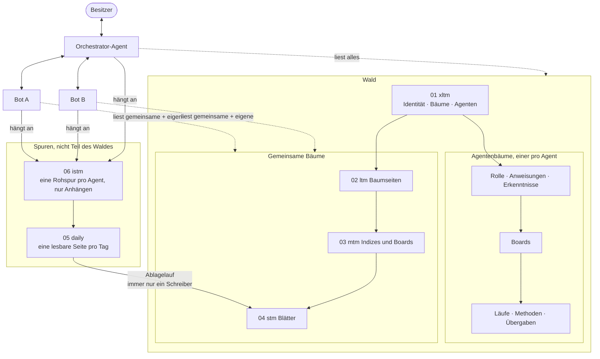

# Agent Memory Forest

**Ein lesbares, nach Regeln gepflegtes lokales Gedächtnis für lange laufende KI-Agenten und Teams von Agenten.**

[English](README.md) · [한국어](README.ko.md) · [简体中文](README.zh-CN.md) · [日本語](README.ja.md) · [Español](README.es.md) · [Français](README.fr.md) · **Deutsch**

[](https://github.com/hyungchulc/agent-memory-forest/actions/workflows/ci.yml)
[](https://www.python.org/)
[](LICENSE)
[](docs/privacy-and-trust.md)

Agent Memory Forest ist ein Python-Paket mit dem Befehl `forest`, das festhält, was Agenten lernen: als
einfache Markdown-Seiten in einigen nummerierten Ordnern auf Ihrem eigenen Datenträger. Jeder Fakt hat genau
einen Ort, und den bestimmen Regeln, nicht der Chat oder der Agent, über den er hereinkam. Wohin eine Seite
gehört und wann ein Subjekt (subject) so weit gewachsen ist, dass es eigene Seiten bekommt, entscheidet Code,
kein Modell.

**Status:** Version `1.0.0b1`, eine Beta: das erste öffentliche Release von Version 1. Der Befehl
`memory-forest` aus 0.3 bleibt daneben installiert ([Archiv](docs/archive-0.3/cli.md)).

> [!IMPORTANT]
> Agent Memory Forest ist weder ein gehosteter Dienst noch ein Autorisierungssystem noch ein Versprechen, dass
> sich ein Agent richtig erinnert. Das Gedächtnis ist Datengrundlage (grounding data): Ein Aufrufer öffnet
> trotzdem die Seite, auf die er verwiesen wurde, prüft, wie aktuell sie ist, und wendet seine eigenen Regeln
> für Befugnisse und Sicherheit an. Der Wald (forest) enthält keine Zugangsdaten, und alles außer der
> optionalen Vektorsuche funktioniert ohne Netzwerk.

## Einstieg

Sie benötigen Python 3.11 oder neuer und ein POSIX-Dateisystem; außerhalb der Standardbibliothek gibt es
keine Laufzeitabhängigkeiten. Unter Windows verwenden Sie WSL2 und legen den Wald im Linux-Dateisystem ab;
lesen Sie zuerst die [WSL2-Anleitung](docs/wsl2.md). Das Paket liegt in keinem Paketindex. Installieren Sie
es über die Adresse des Repositorys:

```sh
python -m pip install "git+https://github.com/hyungchulc/agent-memory-forest"
```

oder aus einem Klon mit `python -m pip install .` in dessen Ordner. `forest --version` prüft die Installation;
wo der Befehl `forest` nicht im Pfad liegt, ist `python -m memory_forest.forest` derselbe Befehl. Sagen Sie
Ihrem Agenten dann einen einzigen Satz:

> Führe `forest guide` aus und folge der Anleitung.

Der Agent bindet sich selbst an. Er führt `forest setup` aus, das ihm die Fragen an Sie liefert, und stellt
Ihnen jede davon: wo der Wald liegt, wie der Agent heißt, ob er Ihr Hauptagent ist, welche Gespräche
eingespielt werden und wer dafür sorgt, dass der Wald weiter wächst. Jede Frage, die Sie zu beantworten haben,
kommt bei Ihnen an; der Agent beantwortet keine davon selbst. Anschließend legt er den Wald an oder tritt dem
von Ihnen genannten bei, registriert den Suchserver in seinem eigenen Tool, spielt sein eigenes Gespräch ein
und weist das Ergebnis mit `forest doctor` nach.

## Was enthalten ist

- **Der Wald und seine Regeln.** Nummerierte Ordner mit einfachen Seiten und ein Vertrag, den jeder Wald
  einhält: [Vertrag](docs/contract.md), für neue Leser erklärt unter [Konzepte](docs/concepts.md).
- **Die Strukturwerkzeuge.** `forest init`, `registry`, `move`, `levels`, `collections`, `record`,
  `archive`, `check`, `lint`, `numbers`, `credentials` und `recover`: [Werkzeuge](docs/tools.md).
- **Finden.** `forest search`, `read`, `timeline` und `navigate` als Befehle sowie `forest mcp`, ein
  MCP-Server mit fünf Tools (`memory_search`, `memory_read`, `memory_timeline`, `memory_navigate`,
  `memory_log`): [Werkzeuge](docs/tools.md#forest-mcp).
- **Zwei Schreibzugänge.** `forest log` oder `memory_log` für den eigenen Turn eines Agenten sowie
  Datensätze in der Form der Spur (lane), die `forest intake --from jsonl` einliest:
  [Werkzeuge](docs/tools.md#forest-intake).
- **Ein Baum (tree) pro Agent.** Gemeinsame Bäume für das, was alle brauchen, ein eigener Baum für jeden
  Agenten und Lesebereiche (reader scopes): [Agenten](docs/multi-agent.md).
- **Guide, Setup und Doctor.** `forest guide` (setup, routine, use, contract), `forest setup` und
  `forest doctor`: [Einen Agenten anbinden](docs/setup.md) und [Werkzeuge](docs/tools.md#forest-guide).

## Was das Paket nicht tut

- **Es liest keine Transkripte bestimmter Agentenprogramme.** Jedes Programm speichert seine Gespräche in
  einem eigenen Format, und das Paket kann nicht mit allen Schritt halten; Reader für einige wenige
  mitzuliefern hieße, etwas zu versprechen, das es nicht halten kann. Ihr Agent kennt sein eigenes Programm:
  Anhand der Anleitung schreibt er einen kleinen Exporter, der seine Turns als Datensätze anhängt. Wer ein
  Programm gut kennt, kann dafür einen Reader schreiben ([Adapter](docs/adapters.md)).
- **Es hat keine Engine und keinen Timer.** Das Tagesprotokoll (daily record), den Ablagelauf (filing run)
  und den Pflegelauf (upkeep run) führt Ihr Agent aus, nach seinem eigenen Zeitplan und mit seinem eigenen
  Modell, gemäß `forest guide routine`. Das Paket ist die prüfende Instanz: `forest check`, `forest lint`,
  `forest levels` und `forest doctor`.
- **Es schreibt nichts in die Einstellungen anderer Programme**, und es hat keine Plugins. Setup schreibt nur
  innerhalb des Waldordners und teilt dem Agenten mit, was er in seinem eigenen Tool registrieren soll.

## Von Hand

Ohne Agent besteht derselbe Weg aus wenigen Befehlen. Ohne Antworten listet Setup die Fragen auf; mit allen
Antworten schreibt es den Wald und gibt sein `todo` aus:

```sh
forest setup                                   # next: ask_owner, dazu jede Frage mit ihrem Flag
forest setup --root studio-forest --as "Kiln Bot" --main yes --conversations all --earlier no \
  --keeper this --when "every night at 23:30" --daily-model "small model" --filing-model "large model"
# next: done
# todo 1. register_mcp  2. bring_turns  3. own_turn  4. routine  5. verify, jeweils mit dem passenden Befehl
```

Arbeiten Sie das `todo` ab: Registrieren Sie `forest mcp --as kiln-bot --root studio-forest` in Ihrem
MCP-Client, und spielen Sie Turns mit dem ausgegebenen Befehl `forest intake` oder mit `forest log` ein.
Weisen Sie es dann nach:

```sh
forest doctor --as "Kiln Bot" --root studio-forest --phrase   # gibt eine neue Phrase aus, die gesagt werden soll
forest log --as kiln-bot --root studio-forest <<'TURN'
Kiln Two fires to cone 5 for now. forest doctor phrase orchid maple amber
TURN
forest index build --root studio-forest
forest doctor --as "Kiln Bot" --root studio-forest              # result: passed (exit 0) oder todo (exit 1)
```

Die Phrase ist jedes Mal neu; spielen Sie die ein, die Ihr Doctor ausgegeben hat. Die Prüfung `finding`
besteht, sobald ein MCP-Client den Server einmal aufgerufen hat; bis dahin meldet der Doctor `todo` und gibt
den Befehl `forest mcp` zum Registrieren aus. Ohne MCP-Client sind die Befehle die Zugänge: Ergänzen Sie die
Doctor-Zeile um `--doors commands`, dann ist die Suche, die der Doctor ausführt, der Nachweis.

Die Antworten sind verbindlich. Der Agent, der den Wald pflegt, liest die Turns aller Agenten und ist deshalb
Ihr Hauptagent (`--keeper this` zusammen mit `--main no` wird erneut abgefragt). Und wenn Sie für einen
Agenten `--conversations none` antworten, weist der Wald selbst dessen Turns ab (`recording_off`), ganz gleich,
welcher Exporter oder Hook noch läuft.

## Dokumentation

| Dokument | Inhalt |
| --- | --- |
| [Konzepte](docs/concepts.md) | der Wald für neue Leser: Schichten, das Leben eines Subjekts, ein Ort pro Fakt, was nach oben wandert, Protokolle, Verschiebungen, der Linter |
| [Vertrag](docs/contract.md) | jede Regel, die ein Wald einhält, genau einmal formuliert |
| [Einen Agenten anbinden](docs/setup.md) | was `forest setup` abfragt und schreibt und was `forest doctor` nachweist |
| [Agenten](docs/multi-agent.md) | Agentenbäume, die zwei Ablagestrategien, Lesebereiche, immer nur ein Schreiber |
| [Design](docs/v1-design.md) | das Paket: Aufbau auf dem Datenträger, Einstellungen, Paketübersicht, Meilensteine |
| [Werkzeuge](docs/tools.md) | `forest move`, `levels`, `collections`, `check`, `lint`, `record`, `numbers`, `intake`, `index`, `search`, `timeline`, `log`, `mcp`, `guide`, `setup` und `doctor` |
| [Einen Reader schreiben](docs/adapters.md) | ein Reader für die eigenen Transkripte eines Agentenprogramms, für jemanden, der dieses Programm kennt |
| `forest guide` | die Setup-Anleitung: die Schritte, mit denen sich ein Agent selbst anbindet |
| `forest guide routine` | die Routine-Anleitung: Tagesprotokoll, Ablagelauf und Pflegelauf, für den Agenten, der den Wald pflegt |
| `forest guide use` | die Nutzungsanleitung: wann und wie ein Agent etwas nachschlägt |
| `forest guide contract` | der Vertrag, wie ihn das installierte Paket ausgibt |
| [Vergleich](docs/comparison.md) | worin sich das Paket von Mem0, GBrain, der LLM-Wiki-Idee und einfachem Vektor-RAG unterscheidet |
| [Datenschutz und Vertrauen](docs/privacy-and-trust.md) | was lokal bleibt, was ein Leser sehen kann, Gedächtnis als nicht vertrauenswürdige Daten |
| [Roadmap](docs/roadmap.md) | die drei Meilensteine und was später kommen kann |
| [WSL2](docs/wsl2.md) | Betrieb unter Windows über WSL2 |
| [Archiv von 0.3](docs/archive-0.3/) | die Dokumente von 0.3, die Version 1 ersetzt |

Die drei Anleitungen und der Vertrag werden im Paket mitgeliefert (`src/memory_forest/guide/`), und die
genannten Befehle geben sie aus; so liest ein Agent die Fassung, die zu seiner installierten Version passt.
Die verlinkten Dokumente sind auf Englisch verfasst.

## Warum es dieses Paket gibt

Ein lange laufender Agent scheitert beim Gedächtnis meist auf eine von zwei Arten: Er behält zu wenig, oder
er häuft einen Stapel an, der so lange wächst, bis sich darin nichts mehr finden lässt und niemand ihn
korrigieren kann. Version 1 beruht auf einigen Eigenschaften, die genau das angehen.

- **Das Subjekt ist die Einheit.** Eine Person, ein Projekt, ein Gerät, ein Agent: Jedes hat eine Zeile in
  der Registry mit seinen Aliasen, und sein Material liegt an seinem eigenen Ort.
- **Den Platz bestimmt der Code.** Die Stufe eines Subjekts (ein Eintrag auf einer gemeinsamen Seite, ein
  Blatt (leaf), ein Ast (branch), ein Baum) richtet sich nach der Zahl der verschiedenen Tage, die sein
  Material abdeckt. Jede Verschiebung läuft über ein einziges Werkzeug, das Verweise umschreibt und die
  Verschiebung protokolliert.
- **Ein Ort für jeden Fakt.** Andere Seiten enthalten eine datierte Verweiszeile statt einer Kopie, sodass
  Fakten nicht auseinanderlaufen können.
- **Die Historie bleibt erhalten.** Ein geänderter Fakt wandert in das Änderungsprotokoll der Seite; lange
  Protokolle werden wortgetreu archiviert; gelöscht wird nichts.
- **Obere Seiten enthalten, was gesichert ist.** Eine Vorliebe gelangt nur bei wiederholten Belegen oder auf
  die eigene Aussage des Besitzers (owner) auf eine Übersichtsseite, nie deshalb, weil sie das zuletzt
  Gesagte ist.
- **Ein Linter mit Codes.** Jede Regel, die eine feste Form hat, wird geprüft, und ein Lauf muss aufräumen,
  was er hinzugefügt hat, ohne von dem blockiert zu werden, was schon vorher da war.
- **Für mehrere Agenten gebaut.** Rohspuren (raw lanes) pro Agent, immer nur ein Schreiber, Lesebereiche
  und zwei Ablagestrategien.

## Der Wald auf einen Blick



Material wandert aus den Spuren nach oben in die Blätter, und nur was die Blätter als gesichert belegen, wird
weiter in die Boards und Baumseiten getragen. Die Zuordnung verläuft umgekehrt: Der Wurzelindex legt fest, zu
welchem Baum eine Art von Subjekt gehört, der Baum legt den Ast fest, und der Ast enthält das Blatt.
[Konzepte](docs/concepts.md) verfolgt das Leben eines Subjekts von einer einmaligen Erwähnung an einem Tag bis
zu einem eigenen Baum.

| Ordner | Inhalt |
| --- | --- |
| `01 xltm/XLTM.md` | der Wurzelindex: wer der Besitzer ist, die Liste der Bäume mit ihren Zuordnungsregeln, die Liste der Agenten |
| `02 ltm/<tree>_LTM.md` | eine Seite pro Baum: Umfang, dauerhafte Muster und Regeln, aktueller Stand, Äste |
| `03 mtm/<tree>/` | der Index des Baums (seine Registry der Subjekte) und ein Board pro Ast |
| `04 stm/<tree>/<branch>/` | die Blätter: je ein Unterthema eines Subjekts, vollständig im Detail, höchstens 8 KB Inhalt |
| `05 daily/` | das lesbare Protokoll jedes Tages (eine Spur) |
| `06 istm/` | das Rohprotokoll, nur durch Anhängen erweitert, eine Spur pro Agent (eine Spur) |
| `.forest/` | die kompilierte Registry, das Verschiebeprotokoll, das Archiv, Indizes und Sperren |

## Agenten in fünf Punkten

Mehrere Agenten teilen sich einen Wald: gemeinsame Bäume für das, was alle brauchen, ein Baum pro Agent für
das, was nur ihn betrifft, und ein Orchestrator, der alles liest. Ein Agent, der über `forest setup`
hinzukommt, hat seinen Baum, sobald Setup mit `done` antwortet. Der Baum jedes anderen Agenten entsteht von
selbst: Schreibt ein Agent die erste Zeile in seine Rohspur, legt der nächste Pflegeschritt seinen Baum an.

```sh
ls "my-forest/06 istm/post-bot"            # hier hat der Agent seine erste Zeile geschrieben
# 2042-05-15.jsonl
forest levels apply --root my-forest       # ein Befehl, derselbe Pflegeschritt, der jede Stufe festlegt
# post-bot: none -> tree (agent; its raw lane holds a file)
ls my-forest/"02 ltm"
# post-bot_LTM.md   studio_LTM.md          # seine Baumseite: Rolle, Anweisungen, Erkenntnisse, aktueller Stand, Äste
```

1. Ein Agent (ein Orchestrator, ein Bot, eine zeitgesteuerte Phase) ist ein Subjekt, das vom ersten Tag an ein
   Baum ist. Ein Turn, den er mit `forest log` oder `memory_log` schreibt, legt den Baum an oder lässt ihn
   ausstehen, bis ihn der nächste Schreibvorgang anlegt, nachdem ein anderer Schreiber die Sperre freigegeben
   hat. Ein Agent ist sein Name, in jeder Schrift. Die exakt gespeicherte ID geht dem Namensschlüssel vor,
   im gesamten Wald und noch vor der Gruppenzugehörigkeit. Namen werden kodiert, wo die Seitensyntax es
   verlangt; einmal zugelassene Namen weist keine zweite Namensregel zurück.
   `forest levels apply` legt den Baum an, den ein Einstellungseintrag oder eine Intake-Spur fällig gemacht hat.
2. Seine Baumseite enthält seine Rolle, dauerhafte Anweisungen, Erkenntnisse, den aktuellen Stand und die Äste.
3. `subject-first` (Standard) legt Fakten am Ort des Subjekts ab, markiert mit `noted by <agent>`;
   `agent-first` legt sie im Baum des Agenten ab, mit Verweisen über `about:`, und teilt einen Fakt, sobald
   zwei Agenten ihn haben.
4. Ein Orchestrator liest den ganzen Wald; andere Agenten lesen die gemeinsamen Bäume und ihren eigenen.
5. Jeder Agent hängt an seine eigene Rohspur an, und immer nur ein Ablagelauf auf einmal schreibt unter einer
   Sperre in den Wald.

Der Commit in die Spur legt `stored` und die Turn-ID fest; IDs, Datensätze zu Aufruferschlüssel und Quelle,
der Baum, der Index und die Verbindungsbuchführung werden daraus abgeleitet, mit `pending` und einem Grund,
solange sie nicht abgeschlossen sind.

Geht die Antwort durch einen Absturz verloren, kann der Aufrufer nicht wissen, ob der Turn gespeichert wurde;
den Aufruf mit seinem Schlüssel zu wiederholen ist sicher.

Einzelheiten: [Agenten](docs/multi-agent.md).

## Alle Befehle

Die Befehle verwenden `--root`, wenn Sie es angeben, und sonst den nächstgelegenen Ordner mit `forest.toml`,
ausgehend vom aktuellen Ordner aufwärts. `forest init` und `forest setup` legen einen Wald an; `forest guide`
braucht keinen. Der folgende Block legt einen Wald an und wechselt hinein, sodass jede weitere Zeile diese
Datei findet.

```sh
# Meilenstein 1: Gerüst und Strukturwerkzeuge
forest init my-forest                          # Einstellungen, Schichten, Wurzelindex
cd my-forest                                   # dieser Ordner ist der Wald, den die Befehle unten verwenden
forest move new-agent studio-hub --name "Studio Hub" --role "orchestrator"   # oder ihn von seiner Spur anlegen lassen
forest registry build                          # jeden Abschnitt ## Subjects kompilieren
forest levels check                            # welche Subjekte und Agenten für eine neue Stufe fällig sind
forest levels apply                            # diese über das Verschiebewerkzeug umsetzen, protokolliert
forest check --sync                            # abgeleitete Listen an die Seiten angleichen, dann alle Prüfungen
forest lint                                    # jede Regel mit fester Form, nach Code
forest repeats check                           # Faktenzeilen, die zwei Blätter desselben Subjekts teilen
forest record kinds                            # die Zeilen der Änderungsprotokolle nach Art
forest numbers check --all                     # Konto-, Karten-, Ausweis- und Telefonnummern in voller Länge

# Meilenstein 2: Anbinden und Finden
forest setup --root . --as "Kiln Bot" --main yes --conversations all --earlier no --keeper nobody
                                               # die Antworten des Besitzers: der Agent, sein Baum, seine Protokolldatei
forest intake --from jsonl --as kiln-bot --transcript transcripts/kiln-bot.jsonl --once
                                               # Datensätze, die ein Exporter angehängt hat, in die Rohspur des Agenten
forest intake status                           # Zeilen, die ein Adapter nicht verstanden hat
forest log --as kiln-bot                       # der Turn wird von stdin gelesen
forest index build                             # .forest/index.sqlite, jederzeit neu erzeugbar
forest search "cone 5" --as kiln-bot           # zuerst Aliase, dann Wörter, innerhalb des Lesebereichs des Lesers
forest timeline query "yesterday evening" --as kiln-bot
forest navigate --as kiln-bot                  # eine Ebene unterhalb des Wurzelindex
forest mcp --as kiln-bot                       # search, read, timeline, navigate, memory_log
forest agents                                  # Gruppen, Spuren und wann jeder Agent zuletzt gesehen wurde
forest guide                                   # die Setup-Anleitung; `routine`, `use` und `contract` sind die anderen Teile
forest setup                                   # ohne Antworten: die Fragen, die ein Agent seinem Besitzer stellt (exit 1)
forest doctor --as kiln-bot                    # weist nach, dass ein Turn ankommt und der MCP-Server aufgerufen wurde (exit 1, bis beides zutrifft)

# Meilenstein 3: Wachsen. Tagesprotokoll, Ablagelauf und Pflegelauf übernimmt Ihr eigener Agent
# gemäß `forest guide routine`; die Befehle oben beurteilen, was er geschrieben hat.
```

Um zu sehen, wie ein Wald aussieht, bevor irgendein Code läuft, lesen Sie den erfundenen
[synthetischen Wald](examples/synthetic-forest/README.md): ein Besitzer, drei gemeinsame Bäume, ein Orchestrator
und zwei Bots, Tagesseiten für zwei Tage und eine Rohspur, etwa vierzig kleine Dateien.

## Status

Agent Memory Forest ist Beta-Software. Die Version in diesem Quellbaum ist 1.0.0b1, das erste öffentliche
Release von Version 1.

- **Geschrieben:** der Vertrag, das Design, die Anleitungen zu Konzepten und Agenten sowie ein erfundener
  synthetischer Wald, der dem Vertrag folgt.
- **Meilenstein 1, Gerüst:** die Strukturbefehle von `forest` (registry, move, levels, collections, record
  mit seinen Historiendateien, archive, `check`, `lint`, das Maskieren von Nummern mit Sternchen, `recover`),
  Agentenbäume, die aus ihren Spuren oder Einstellungen entstehen, und ein Undo-Journal für jeden Commit, mit
  Tests auf erfundenen Wäldern und einem synthetischen Wald, der jede Prüfung besteht.
- **Meilenstein 2, Anbinden und Finden:** `forest intake` liest Datensätze in der Form der Spur (über den
  Adapter `jsonl` oder einen Adapter, den jemand über die Entry-Point-Gruppe `memory_forest.adapters`
  einbindet) in die Rohspur des jeweiligen Agenten ein, und `forest log` und `memory_log` schreiben den
  eigenen Turn eines Agenten. `forest index` baut den Suchindex (`.forest/index.sqlite`, bis
  `forest index reset` auf eine neue Datei verweist). `forest search`, `forest read`, `forest timeline` und
  `forest navigate` antworten daraus, innerhalb von `agents.readable_trees`, und `forest mcp` stellt search,
  read, timeline, navigate und `memory_log` bereit. Der Agent des Besitzers bindet sich mit `forest guide`,
  `forest setup` und `forest doctor` selbst an ([Design, Abschnitt 15](docs/v1-design.md#15-connecting-agents)).
- **Meilenstein 3, Wachsen:** Tagesprotokoll, Ablagelauf und nächtliche Pflege übernimmt der eigene Agent des
  Besitzers, gemäß dem Vertrag (Abschnitt 10) und `forest guide routine`.
- **Nicht Teil dieses Releases:** Reader für die eigenen Transkripte bestimmter Agentenprogramme (wer ein
  Programm kennt, schreibt dessen Reader, [Adapter](docs/adapters.md)) und eine Engine, die die Phasen
  Tagesprotokoll, Ablage und Pflege ausführt.

Der Code von 0.3 (`memory-forest`) bleibt in diesem Quellbaum neben Version 1 erhalten. Er eignet sich zur
Evaluierung und Anpassung, nicht für unbeaufsichtigte Entscheidungen mit hoher Tragweite.

## Mitwirken

Lesen Sie [CONTRIBUTING.md](CONTRIBUTING.md). Verwenden Sie nur erfundene Fixtures, halten Sie echte Wälder
aus Git heraus, und führen Sie vor dem Öffnen eines Pull Requests die vollständige lokale Prüfung aus.

```sh
make check
```

Sicherheitsprobleme werden nach [SECURITY.md](SECURITY.md) behandelt. Für die Mitwirkung in der Community
gilt [CODE_OF_CONDUCT.md](CODE_OF_CONDUCT.md).

## Lizenz

Agent Memory Forest wird unter der [MIT-Lizenz](LICENSE) veröffentlicht.
