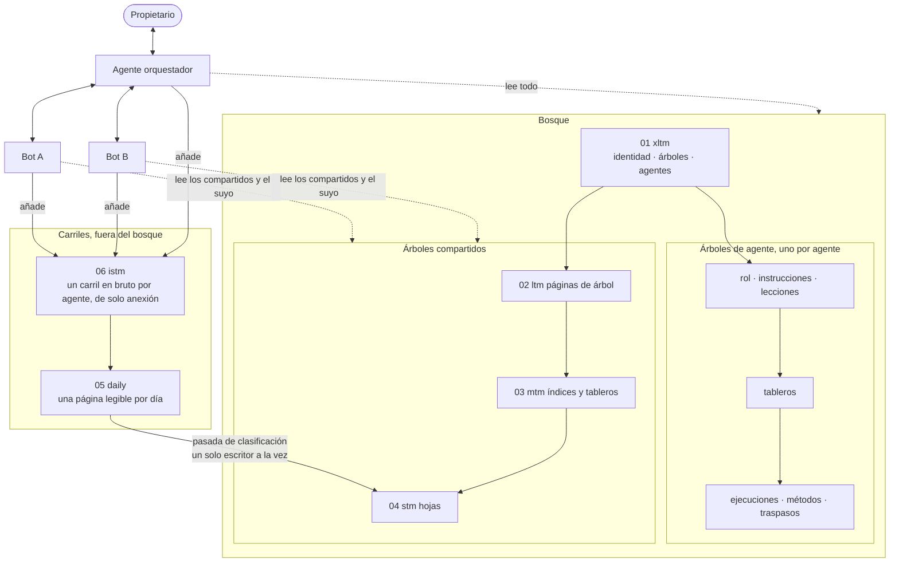

# Agent Memory Forest

**Una memoria local, legible y mantenida por reglas, para agentes de IA de larga duración y equipos de agentes.**

[English](README.md) · [한국어](README.ko.md) · [简体中文](README.zh-CN.md) · [日本語](README.ja.md) · **Español** · [Français](README.fr.md) · [Deutsch](README.de.md)

[](https://github.com/hyungchulc/agent-memory-forest/actions/workflows/ci.yml)
[](https://www.python.org/)
[](LICENSE)
[](docs/privacy-and-trust.md)

Agent Memory Forest es un paquete de Python y un comando `forest` que guardan lo que aprenden los agentes como
páginas Markdown simples, en unas pocas carpetas numeradas de tu propio disco. Cada dato tiene un único lugar,
que deciden las reglas y no la conversación ni el agente que lo trajo, y es el código, no un modelo, el que
decide dónde va una página y cuándo una entidad (subject) ha crecido lo suficiente como para tener páginas
propias.

**Estado:** versión `1.0.0b1`, una beta: el primer lanzamiento público de la versión 1. El comando
`memory-forest` de la 0.3 sigue instalado junto a ella ([archivo](docs/archive-0.3/cli.md)).

> [!IMPORTANT]
> Agent Memory Forest no es un servicio alojado, ni un sistema de autorización, ni una garantía de que un agente
> vaya a recordar correctamente. La memoria son datos de fundamentación (grounding): quien la consulta abre
> igualmente la página a la que se le remitió, comprueba cuán reciente es y aplica sus propias reglas de
> autoridad y de seguridad. El bosque (forest) no guarda credenciales, y todo, salvo la búsqueda vectorial
> opcional, funciona sin red.

## Por dónde empezar

Necesitas Python 3.11 o posterior y un sistema de archivos POSIX; no hay dependencias en tiempo de ejecución
fuera de la biblioteca estándar. En Windows, usa WSL2 y mantén el bosque en el sistema de archivos de Linux;
lee primero la [guía de WSL2](docs/wsl2.md). El paquete no está en ningún índice de paquetes. Instálalo desde
la dirección del repositorio:

```sh
python -m pip install "git+https://github.com/hyungchulc/agent-memory-forest"
```

o desde un clon, con `python -m pip install .` en su carpeta. `forest --version` comprueba la instalación; si
el comando `forest` no está en el PATH, `python -m memory_forest.forest` es el mismo comando. Después, dile una
sola frase a tu agente:

> Ejecuta `forest guide` y síguela.

El agente se conecta solo. Ejecuta `forest setup`, que le entrega las preguntas que debe hacerte, y te las
hace una por una: dónde vive el bosque, el nombre del agente, si es tu agente principal, qué conversaciones
entran y quién se encarga de que el bosque siga creciendo. Cada pregunta que te corresponde responder te llega
a ti; el agente nunca responde ninguna por su cuenta. Después crea el bosque o se une al que indicaste, registra
el servidor de búsqueda en su propia herramienta, incorpora su propia conversación y demuestra el resultado
con `forest doctor`.

## Qué incluye

- **El bosque y sus reglas.** Carpetas numeradas de páginas simples y un contrato que todo bosque cumple:
  [contrato](docs/contract.md), explicado en [conceptos](docs/concepts.md) para quien llega por primera vez.
- **Las herramientas de estructura.** `forest init`, `registry`, `move`, `levels`, `collections`, `record`,
  `archive`, `check`, `lint`, `numbers`, `credentials` y `recover`: [herramientas](docs/tools.md).
- **Búsqueda.** `forest search`, `read`, `timeline` y `navigate` como comandos, y `forest mcp`, un servidor
  MCP con cinco herramientas (`memory_search`, `memory_read`, `memory_timeline`, `memory_navigate`,
  `memory_log`): [herramientas](docs/tools.md#forest-mcp).
- **Dos puertas de escritura.** `forest log` o `memory_log` para el turno propio de un agente, y registros con
  la forma del carril (lane), que lee `forest intake --from jsonl`: [herramientas](docs/tools.md#forest-intake).
- **Un árbol (tree) por agente.** Árboles compartidos para lo que todos necesitan, un árbol propio para cada
  agente y ámbitos de lectura: [agentes](docs/multi-agent.md).
- **La guía, setup y doctor.** `forest guide` (setup, routine, use, contract), `forest setup` y
  `forest doctor`: [conectar un agente](docs/setup.md) y [herramientas](docs/tools.md#forest-guide).

## Qué no hace

- **No lee las transcripciones de ningún programa de agentes en particular.** Cada programa guarda su
  conversación en su propio formato, y el paquete no puede seguirles el ritmo a todos; incluir lectores para
  unos pocos sería prometer lo que no puede cumplir. Tu agente conoce su propio programa: siguiendo la guía,
  escribe un pequeño exportador que añade sus turnos como registros. Quien conozca bien un programa puede
  escribir un lector para él ([adaptadores](docs/adapters.md)).
- **No tiene motor ni temporizador.** El registro diario (daily record), la pasada de clasificación (filing
  run) y la pasada de mantenimiento (upkeep) las lleva a cabo tu agente, con su propio horario y su propio
  modelo, siguiendo `forest guide routine`. El paquete es el juez: `forest check`, `forest lint`,
  `forest levels` y `forest doctor`.
- **No escribe nada en la configuración de otro programa**, y no tiene plugins. Setup solo escribe dentro de
  la carpeta del bosque y le indica al agente qué debe registrar en su propia herramienta.

## A mano

Sin un agente, el mismo recorrido se reduce a unos pocos comandos. Ejecutado sin respuestas, setup lista las
preguntas; con todas las respuestas, escribe el bosque e imprime su `todo`:

```sh
forest setup                                   # next: ask_owner, y cada pregunta con su opción
forest setup --root studio-forest --as "Kiln Bot" --main yes --conversations all --earlier no \
  --keeper this --when "every night at 23:30" --daily-model "small model" --filing-model "large model"
# next: done
# todo 1. register_mcp  2. bring_turns  3. own_turn  4. routine  5. verify, cada uno con su comando
```

Lleva a cabo el `todo`: registra `forest mcp --as kiln-bot --root studio-forest` en tu cliente MCP e
incorpora turnos con el comando `forest intake` impreso o con `forest log`. Después, demuéstralo:

```sh
forest doctor --as "Kiln Bot" --root studio-forest --phrase   # imprime una frase nueva que decir
forest log --as kiln-bot --root studio-forest <<'TURN'
Kiln Two fires to cone 5 for now. forest doctor phrase orchid maple amber
TURN
forest index build --root studio-forest
forest doctor --as "Kiln Bot" --root studio-forest              # result: passed (exit 0) o todo (exit 1)
```

La frase es nueva cada vez; incorpora la que imprimió tu doctor. La comprobación `finding` pasa cuando un
cliente MCP ha llamado al servidor una vez; hasta entonces, doctor responde `todo` e imprime el comando
`forest mcp` que hay que registrar. Sin cliente MCP, los comandos son las puertas: añade `--doors commands` a
la línea de doctor, y la búsqueda que ejecuta doctor sirve de prueba.

Las respuestas se hacen cumplir. El agente que se encarga del bosque lee los turnos de todos los agentes, así
que es tu agente principal (`--keeper this` con `--main no` se vuelve a preguntar). Y cuando respondes
`--conversations none` para un agente, el propio bosque rechaza los turnos de ese agente (`recording_off`),
aunque siga ejecutándose algún exportador o hook.

## Documentación

| Documento | Qué cubre |
| --- | --- |
| [Conceptos](docs/concepts.md) | el bosque para quien llega por primera vez: capas, la vida de una entidad, un único lugar, qué sube, registros, movimientos, el linter |
| [Contrato](docs/contract.md) | todas las reglas que cumple un bosque, enunciadas una sola vez |
| [Conectar un agente](docs/setup.md) | qué pregunta y qué escribe `forest setup`, y qué demuestra `forest doctor` |
| [Agentes](docs/multi-agent.md) | árboles de agente, las dos políticas de clasificación, ámbitos de lectura, el escritor único |
| [Diseño](docs/v1-design.md) | el paquete: estructura en disco, configuración, mapa del paquete, hitos |
| [Herramientas](docs/tools.md) | `forest move`, `levels`, `collections`, `check`, `lint`, `record`, `numbers`, `intake`, `index`, `search`, `timeline`, `log`, `mcp`, `guide`, `setup` y `doctor` |
| [Escribir un lector](docs/adapters.md) | un lector de las transcripciones propias de un programa de agentes, para quien conoce ese programa |
| `forest guide` | la guía de configuración: los pasos que sigue un agente para conectarse solo |
| `forest guide routine` | la guía de rutina: el registro diario, la pasada de clasificación y la pasada de mantenimiento, para el agente que se encarga del bosque |
| `forest guide use` | la guía de uso: cuándo y cómo consulta un agente |
| `forest guide contract` | el contrato, tal como lo imprime el paquete instalado |
| [Comparación](docs/comparison.md) | en qué se diferencia de Mem0, GBrain, la idea de LLM Wiki y el RAG vectorial simple |
| [Privacidad y confianza](docs/privacy-and-trust.md) | qué se queda en local, qué puede ver un lector, la memoria como datos no confiables |
| [Hoja de ruta](docs/roadmap.md) | los tres hitos y lo que podría venir después |
| [WSL2](docs/wsl2.md) | ejecutarlo en Windows mediante WSL2 |
| [Archivo de la 0.3](docs/archive-0.3/) | los documentos de la 0.3 que reemplaza la versión 1 |

Las tres guías y el contrato vienen dentro del paquete (`src/memory_forest/guide/`) y esos comandos los
imprimen, de modo que un agente lee la copia que corresponde a la versión que tiene instalada. Los documentos
enlazados están en inglés.

## Por qué existe

Un agente de larga duración suele fallar con la memoria de una de dos maneras: guarda demasiado poco, o guarda
un montón que crece hasta que ya no se puede encontrar nada en él y nadie puede corregirlo. La versión 1 se
apoya en unas pocas propiedades que atacan ese problema directamente.

- **La unidad es la entidad.** Una persona, un proyecto, un dispositivo, un agente: cada uno tiene una línea
  en el registro (registry) con sus alias, y su material vive en su propio lugar.
- **Los lugares los decide el código.** El nivel de una entidad (una entrada en una página compartida, una
  hoja, una rama, un árbol) depende del número de días distintos que abarca su material. Cada movimiento pasa
  por una única herramienta que reescribe las referencias y deja constancia del movimiento.
- **Un único lugar para cada dato.** Las demás páginas llevan una línea de referencia con fecha, no una copia,
  así que los datos no pueden divergir.
- **La historia se conserva.** Un dato que cambia pasa al registro de cambios de la página; los registros
  largos se archivan tal cual; no se borra nada.
- **Las páginas superiores contienen lo establecido.** Una preferencia llega a una página de resumen solo con
  evidencia repetida o con las propias palabras del propietario (owner), nunca por ser lo último que se dijo.
- **Un linter con códigos.** Toda regla que tiene forma se comprueba, y una ejecución debe limpiar lo que
  añadió sin quedar bloqueada por lo que ya estaba.
- **Pensado para varios agentes.** Carriles en bruto (raw lanes) por agente, un solo escritor a la vez,
  ámbitos de lectura y dos políticas de clasificación.

## El bosque en una imagen



El material sube desde los carriles hasta las hojas (leaves), y solo lo que las hojas establecen se lleva
hasta los tableros y las páginas de árbol. La ubicación va en sentido contrario: el índice raíz dice a qué
árbol pertenece cada tipo de entidad, el árbol dice en qué rama (branch) y la rama contiene la hoja.
[Conceptos](docs/concepts.md) recorre la vida de una entidad, desde una mención de un solo día hasta un árbol
propio.

| Carpeta | Contiene |
| --- | --- |
| `01 xltm/XLTM.md` | el índice raíz: quién es el propietario, la lista de árboles con sus reglas de ubicación, la lista de agentes |
| `02 ltm/<tree>_LTM.md` | una página por árbol: alcance, patrones y reglas duraderos, estado actual, ramas |
| `03 mtm/<tree>/` | el índice del árbol (su registro de entidades) y un tablero por rama |
| `04 stm/<tree>/<branch>/` | las hojas: cada una, un subtema de una entidad, con todo detalle, con un máximo de 8 KB de contenido |
| `05 daily/` | el registro legible de cada día (un carril) |
| `06 istm/` | el registro en bruto, de solo anexión, un carril por agente (un carril) |
| `.forest/` | el registro de entidades compilado, el historial de movimientos, el archivo, los índices y los bloqueos |

## Los agentes en cinco líneas

Varios agentes comparten un bosque: árboles compartidos para lo que todos necesitan, un árbol por agente para
lo que es suyo, y un orquestador que lo lee todo. Un agente que se une con `forest setup` ya tiene su árbol
cuando setup responde `done`. El árbol de cualquier otro agente aparece solo: cuando un agente escribe la
primera línea en su carril en bruto, el siguiente paso de mantenimiento crea su árbol.

```sh
ls "my-forest/06 istm/post-bot"            # el agente escribió aquí su primera línea
# 2042-05-15.jsonl
forest levels apply --root my-forest       # un comando, el mismo paso de mantenimiento que resuelve todos los niveles
# post-bot: none -> tree (agent; its raw lane holds a file)
ls my-forest/"02 ltm"
# post-bot_LTM.md   studio_LTM.md          # su página de árbol: rol, instrucciones, lecciones, estado actual, ramas
```

1. Un agente (un orquestador, un bot, una etapa programada) es una entidad que es un árbol desde su primer día.
   Un turno que escribe con `forest log` o `memory_log` crea el árbol, o lo deja pendiente para la siguiente
   escritura después de que otro escritor libere el bloqueo. Un agente es su nombre, en cualquier sistema de
   escritura. El id almacenado exacto tiene prioridad sobre la clave del nombre, en todo el bosque, y antes
   que la pertenencia a un grupo. Los nombres se codifican donde la sintaxis de la página lo requiere; un nombre ya
   admitido nunca lo rechaza una segunda regla de nombres.
   `forest levels apply` crea el árbol que una entrada de configuración o un carril de ingesta dejó pendiente.
2. Su página de árbol contiene su rol, sus instrucciones permanentes, sus lecciones, su estado actual y sus
   ramas.
3. `subject-first` (predeterminado) clasifica los datos en el lugar de la entidad, marcados con
   `noted by <agent>`; `agent-first` los clasifica en el árbol del agente con punteros `about:`, y comparte un
   dato en cuanto dos agentes lo tienen.
4. Un orquestador lee todo el bosque; los demás agentes leen los árboles compartidos y el suyo.
5. Cada agente añade al final de su propio carril en bruto, y una sola pasada de clasificación a la vez
   escribe en el bosque bajo un bloqueo.

El commit en el carril fija `stored` y el id del turno; los ids, los registros de clave del llamador y de origen, el árbol, el índice y la contabilidad de conexiones se derivan de él, con `pending` y un motivo cuando quedan sin terminar.

Si un fallo hace que se pierda la respuesta, quien llama no puede saber si el turno quedó almacenado; repetir la llamada con su clave es seguro.

Detalles: [Agentes](docs/multi-agent.md).

## Todos los comandos

Los comandos usan `--root` cuando lo indicas y, si no, la carpeta más cercana, en la actual o por encima de
ella, que contenga `forest.toml`. `forest init` y `forest setup` crean un bosque; `forest guide` no necesita
ninguno. El bloque siguiente crea un bosque y entra en él, para que cada línea posterior encuentre ese archivo.

```sh
# Hito 1: esqueleto y herramientas de estructura
forest init my-forest                          # configuración, capas, índice raíz
cd my-forest                                   # esta carpeta es el bosque que usan los comandos de abajo
forest move new-agent studio-hub --name "Studio Hub" --role "orchestrator"   # o deja que lo cree su carril
forest registry build                          # compila todas las secciones ## Subjects
forest levels check                            # qué entidades y agentes deben pasar a un nuevo nivel
forest levels apply                            # los aplica mediante la herramienta de movimiento, con registro
forest check --sync                            # alinea las listas derivadas con las páginas y luego hace todas las comprobaciones
forest lint                                    # toda regla con forma, por código
forest repeats check                           # líneas de datos que comparten dos hojas de una misma entidad
forest record kinds                            # las líneas de los registros de cambios, por tipo
forest numbers check --all                     # números de cuenta, tarjeta, identidad y teléfono escritos completos

# Hito 2: conexión y búsqueda
forest setup --root . --as "Kiln Bot" --main yes --conversations all --earlier no --keeper nobody
                                               # las respuestas del propietario: el agente, su árbol, su archivo de registros
forest intake --from jsonl --as kiln-bot --transcript transcripts/kiln-bot.jsonl --once
                                               # registros que añadió un exportador, al carril en bruto del agente
forest intake status                           # líneas que un adaptador no entendió
forest log --as kiln-bot                       # el turno se lee de stdin
forest index build                             # .forest/index.sqlite, se puede reconstruir
forest search "cone 5" --as kiln-bot           # primero los alias, luego las palabras, dentro del ámbito del lector
forest timeline query "yesterday evening" --as kiln-bot
forest navigate --as kiln-bot                  # un nivel por debajo del índice raíz
forest mcp --as kiln-bot                       # search, read, timeline, navigate, memory_log
forest agents                                  # grupos, carriles y cuándo se vio por última vez a cada agente
forest guide                                   # la guía de configuración; `routine`, `use` y `contract` son las otras partes
forest setup                                   # sin respuestas: las preguntas que un agente le hace a su propietario (exit 1)
forest doctor --as kiln-bot                    # demuestra que llega un turno y que se llamó al servidor MCP (exit 1 hasta que se cumplan ambos)

# Hito 3: crecimiento. Tu propio agente lleva a cabo el registro diario, la pasada de clasificación y la
# pasada de mantenimiento, siguiendo `forest guide routine`; los comandos de arriba juzgan lo que escribió.
```

Para ver cómo es un bosque antes de que se ejecute ningún código, lee el
[bosque sintético](examples/synthetic-forest/README.md) inventado: un propietario, tres árboles compartidos,
un orquestador y dos bots, dos días de páginas diarias y un carril en bruto, unos cuarenta archivos pequeños.

## Estado

Agent Memory Forest es software beta. La versión de este árbol de código es la 1.0.0b1, el primer lanzamiento
público de la versión 1.

- **Escrito:** el contrato, el diseño, las guías de conceptos y de agentes, y un bosque sintético inventado
  que sigue el contrato.
- **Hito 1, esqueleto:** los comandos de estructura de `forest` (registry, move, levels, collections, record
  con sus archivos de historial, archive, `check`, `lint`, enmascarado de números, `recover`), árboles de
  agente creados a partir de sus carriles o de la configuración, y un journal para deshacer cada commit, con
  pruebas sobre bosques inventados y el bosque sintético superando todas las comprobaciones.
- **Hito 2, conexión y búsqueda:** `forest intake` lee registros con la forma del carril (el adaptador
  `jsonl`, o un adaptador que alguien conecte mediante el grupo de entry points `memory_forest.adapters`) y los
  lleva al carril en bruto de ese agente, y `forest log` y `memory_log` escriben el turno propio de un agente.
  `forest index` construye el índice de búsqueda (`.forest/index.sqlite` hasta que `forest index reset` apunte
  a un archivo nuevo). `forest search`, `forest read`, `forest timeline` y `forest navigate` responden a partir
  de él, dentro de `agents.readable_trees`, y `forest mcp` ofrece search, read, timeline, navigate y
  `memory_log`. El agente del propietario se conecta solo con `forest guide`, `forest setup` y `forest doctor`
  ([diseño, sección 15](docs/v1-design.md#15-connecting-agents)).
- **Hito 3, crecimiento:** el registro diario, la pasada de clasificación y el mantenimiento nocturno los
  lleva a cabo el propio agente del propietario, siguiendo el contrato (sección 10) y `forest guide routine`.
- **Fuera de este lanzamiento:** lectores de las transcripciones propias de programas de agentes concretos
  (quien conoce un programa escribe su lector, [adaptadores](docs/adapters.md)), y un motor que ejecute las
  etapas diaria, de clasificación y de mantenimiento.

El código de la 0.3 (`memory-forest`) se mantiene en este árbol de código junto a la versión 1. Es adecuado
para evaluación y adaptación, no para decisiones de alto impacto sin supervisión.

## Cómo contribuir

Lee [CONTRIBUTING.md](CONTRIBUTING.md). Usa solo fixtures inventados, mantén los bosques reales fuera de Git y
ejecuta la comprobación local completa antes de abrir un pull request.

```sh
make check
```

Los problemas de seguridad se gestionan según [SECURITY.md](SECURITY.md). La participación en la comunidad se
rige por [CODE_OF_CONDUCT.md](CODE_OF_CONDUCT.md).

## Licencia

Agent Memory Forest se publica bajo la [Licencia MIT](LICENSE).
