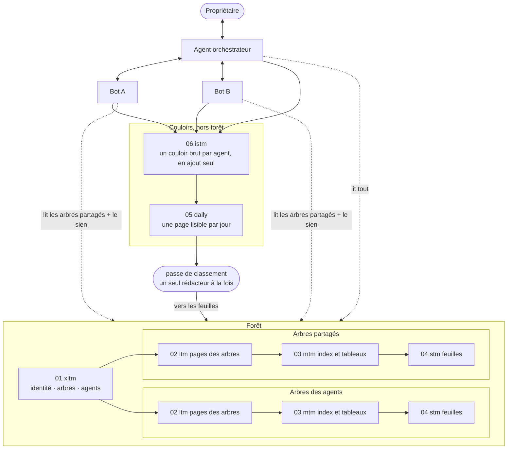
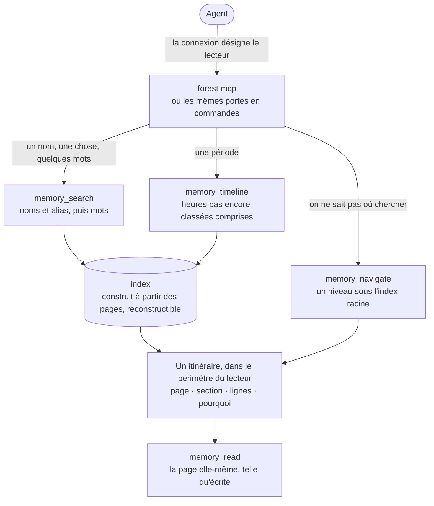

# Agent Memory Forest

**Une mémoire locale, lisible et tenue par des règles, pour les agents d'IA au long cours et les équipes d'agents.**

[English](README.md) · [한국어](README.ko.md) · [简体中文](README.zh-CN.md) · [日本語](README.ja.md) · [Español](README.es.md) · **Français** · [Deutsch](README.de.md)

[](https://github.com/hyungchulc/agent-memory-forest/actions/workflows/ci.yml)
[](https://www.python.org/)
[](LICENSE)
[](docs/privacy-and-trust.md)
[](https://github.com/hyungchulc/agent-memory-forest/stargazers)

⭐ Si Agent Memory Forest vous est utile, mettez-lui une étoile sur GitHub. Cela aide d'autres personnes à le trouver.

https://github.com/user-attachments/assets/a45d205e-bedd-4887-903d-bd44253ddd80

Agent Memory Forest est un paquet Python et une commande `forest` qui conservent ce que les agents apprennent
sous forme de pages Markdown ordinaires, rangées dans quelques dossiers numérotés sur votre propre disque. Chaque
fait a un seul emplacement, fixé par des règles et non par la conversation ou l'agent qui l'a apporté ; et c'est
du code, pas un modèle, qui décide où une page doit se trouver et à quel moment un sujet (subject) a assez grandi
pour avoir ses propres pages.

**État :** version `1.0.0b1`, une bêta : la première publication publique de la version 1. La commande
`memory-forest` de la 0.3 reste installée à côté ([archive](docs/archive-0.3/cli.md)).

> [!IMPORTANT]
> Agent Memory Forest n'est ni un service hébergé, ni un système d'autorisation, ni la promesse qu'un agent se
> souviendra correctement. La mémoire est une donnée d'ancrage (grounding data) : un appelant ouvre malgré tout
> la page vers laquelle il a été orienté, vérifie à quel point elle est récente et applique ses propres règles
> d'autorité et de sécurité. La forêt (forest) ne contient aucun identifiant secret (credentials), et tout, sauf
> la recherche vectorielle facultative, fonctionne sans réseau.

## Pour commencer

Il vous faut Python 3.11 ou plus récent et un système de fichiers POSIX ; le paquet n'a aucune dépendance
d'exécution en dehors de la bibliothèque standard. Sous Windows, utilisez WSL2 et placez la forêt sur le système
de fichiers Linux ; lisez d'abord le [guide WSL2](docs/wsl2.md). Le paquet est sur PyPI. Cette version est une
bêta, installez-la donc avec une version figée, ou avec `--pre` :

```sh
python -m pip install "agent-memory-forest==1.0.0b1"
# ou, sans figer la version :
python -m pip install --pre agent-memory-forest
```

Pour l'installer depuis un clone, exécutez `python -m pip install .` dans son dossier. `forest --version` vérifie l'installation ;
si la commande `forest` n'est pas dans le PATH, `python -m memory_forest.forest` est la même commande. Dites
ensuite une seule phrase à votre agent :

> Exécute `forest guide` et suis-le.

L'agent se connecte lui-même. Il lance `forest setup`, qui lui fournit les questions à vous poser, et vous les
pose une à une : où se trouve la forêt, le nom de l'agent, s'il est votre agent principal, quelles conversations
entrent dans la forêt et qui la fait grandir. Toute question à laquelle il vous revient de répondre vous est
posée ; l'agent n'y répond jamais lui-même. Il crée ensuite la forêt ou rejoint celle que vous avez indiquée,
enregistre le serveur de recherche dans son propre outil, fait entrer sa propre conversation et prouve le
résultat avec `forest doctor`.

## Ce que vous obtenez

- **La forêt et ses règles.** Des dossiers numérotés de pages ordinaires, et un contrat que toute forêt respecte :
  [contrat](docs/contract.md), expliqué pour un nouveau lecteur dans [concepts](docs/concepts.md).
- **Les outils de structure.** `forest init`, `registry`, `move`, `levels`, `collections`, `record`,
  `archive`, `check`, `lint`, `numbers`, `credentials` et `recover` : [outils](docs/tools.md).
- **La recherche.** `forest search`, `read`, `timeline` et `navigate` sous forme de commandes, et `forest mcp`,
  un serveur MCP doté de cinq outils (`memory_search`, `memory_read`, `memory_timeline`, `memory_navigate`,
  `memory_log`) : [outils](docs/tools.md#forest-mcp).
- **Deux portes d'écriture.** `forest log` ou `memory_log`, par lesquels un agent écrit son propre tour (turn),
  et des enregistrements au format du couloir (lane), lus par `forest intake --from jsonl` :
  [outils](docs/tools.md#forest-intake).
- **Un arbre par agent.** Des arbres (trees) partagés pour ce dont tout le monde a besoin, un arbre propre à
  chaque agent, et des périmètres de lecture : [agents](docs/multi-agent.md).
- **Le guide, setup et doctor.** `forest guide` (setup, routine, use, contract), `forest setup` et
  `forest doctor` : [connecter un agent](docs/setup.md) et [outils](docs/tools.md#forest-guide).

## Ce que le paquet ne fait pas

- **Il ne lit les transcriptions d'aucun programme d'agent en particulier.** Chaque programme conserve sa
  conversation dans son propre format, et le paquet ne peut pas suivre tous ces formats ; livrer des lecteurs
  pour quelques-uns reviendrait à promettre ce qu'il ne peut pas tenir. Votre agent connaît son propre programme :
  en suivant le guide, il écrit un petit exporteur qui ajoute ses tours sous forme d'enregistrements. Une
  personne qui connaît bien un programme peut écrire un lecteur pour celui-ci ([adaptateurs](docs/adapters.md)).
- **Il n'a ni moteur ni minuteur.** Le journal quotidien (daily record), la passe de classement (filing run) et
  la passe d'entretien (upkeep) sont exécutés par votre agent, selon son propre calendrier et avec son propre
  modèle, en suivant `forest guide routine`. C'est le paquet qui juge : `forest check`, `forest lint`,
  `forest levels` et `forest doctor`.
- **Il n'écrit rien dans les réglages d'un autre programme**, et il n'a pas de plugins. La configuration n'écrit
  qu'à l'intérieur du dossier de la forêt et indique à l'agent ce qu'il doit enregistrer dans son propre outil.

## À la main

Sans agent, le même parcours tient en quelques commandes. Sans réponses, setup liste les questions ; avec toutes
les réponses, il écrit la forêt et affiche son `todo` :

```sh
forest setup                                   # next: ask_owner, puis chaque question avec son option
forest setup --root studio-forest --as "Kiln Bot" --main yes --conversations all --earlier no \
  --keeper this --when "every night at 23:30" --daily-model "small model" --filing-model "large model"
# next: done
# todo 1. register_mcp  2. bring_turns  3. own_turn  4. routine  5. verify, chacune avec sa commande
```

Exécutez le `todo` : enregistrez `forest mcp --as kiln-bot --root studio-forest` dans votre client MCP, et
faites entrer les tours avec la commande `forest intake` affichée ou avec `forest log`. Puis faites-en la
preuve :

```sh
forest doctor --as "Kiln Bot" --root studio-forest --phrase   # affiche une nouvelle phrase à dire
forest log --as kiln-bot --root studio-forest <<'TURN'
Kiln Two fires to cone 5 for now. forest doctor phrase orchid maple amber
TURN
forest index build --root studio-forest
forest doctor --as "Kiln Bot" --root studio-forest              # result: passed (exit 0) ou todo (exit 1)
```

La phrase change à chaque fois ; faites entrer celle que votre doctor a affichée. La vérification `finding`
passe dès qu'un client MCP a appelé le serveur une fois ; jusque-là, doctor répond `todo` et affiche la commande
`forest mcp` à enregistrer. Sans client MCP, ce sont les commandes qui servent de portes : ajoutez
`--doors commands` à la ligne de doctor, et la recherche que lance doctor sert de preuve.

Les réponses sont respectées. L'agent qui entretient la forêt lit les tours de tous les agents ; c'est donc
votre agent principal (`--keeper this` avec `--main no` fait reposer la question). Et lorsque vous répondez
`--conversations none` pour un agent, la forêt elle-même refuse les tours de cet agent (`recording_off`), quel
que soit l'exporteur ou le hook qui tourne encore.

## Documentation

| Document | Contenu |
| --- | --- |
| [Concepts](docs/concepts.md) | la forêt pour un nouveau lecteur : couches, vie d'un sujet, emplacement unique, ce qui remonte, historiques, déplacements, le linter |
| [Contrat](docs/contract.md) | chaque règle qu'une forêt respecte, énoncée une seule fois |
| [Connecter un agent](docs/setup.md) | ce que `forest setup` demande et écrit, et ce que `forest doctor` prouve |
| [Agents](docs/multi-agent.md) | arbres d'agent, les deux politiques de classement, périmètres de lecture, le rédacteur unique |
| [Conception](docs/v1-design.md) | le paquet : structure sur disque, réglages, carte du paquet, jalons |
| [Outils](docs/tools.md) | `forest move`, `levels`, `collections`, `check`, `lint`, `record`, `numbers`, `intake`, `index`, `search`, `timeline`, `log`, `mcp`, `guide`, `setup` et `doctor` |
| [Écrire un lecteur](docs/adapters.md) | un lecteur des transcriptions propres à un programme d'agent, pour qui connaît ce programme |
| `forest guide` | le guide de configuration : les étapes que suit un agent pour se connecter lui-même |
| `forest guide routine` | le guide de routine : le journal quotidien, la passe de classement et la passe d'entretien, pour l'agent qui entretient la forêt |
| `forest guide use` | le guide d'utilisation : quand et comment un agent cherche une information |
| `forest guide contract` | le contrat, tel que l'affiche le paquet installé |
| [Comparaison](docs/comparison.md) | en quoi ce projet diffère de Mem0, de GBrain, de l'idée du LLM Wiki et d'un RAG vectoriel classique |
| [Confidentialité et confiance](docs/privacy-and-trust.md) | ce qui reste en local, ce qu'un lecteur peut voir, la mémoire comme donnée non fiable |
| [Feuille de route](docs/roadmap.md) | les trois jalons et ce qui pourrait venir ensuite |
| [WSL2](docs/wsl2.md) | l'utilisation sous Windows via WSL2 |
| [Archive de la 0.3](docs/archive-0.3/) | les documents de la 0.3 que la version 1 remplace |

Les trois guides et le contrat sont livrés dans le paquet (`src/memory_forest/guide/`) et ces commandes les
affichent ; un agent lit ainsi la copie qui correspond à la version qu'il a installée. Les documents liés sont
rédigés en anglais.

## Pourquoi ce projet

Un agent qui tourne longtemps échoue généralement avec sa mémoire de l'une de deux façons : il garde trop peu, ou
il garde un tas qui grossit jusqu'à ce que plus rien n'y soit trouvable et que personne ne puisse le corriger. La
version 1 repose sur quelques propriétés qui répondent directement à ce problème.

- **L'unité, c'est le sujet.** Une personne, un projet, un appareil, un agent : chacun a une ligne de registre
  avec ses alias, et son contenu vit à son propre emplacement.
- **Les emplacements sont décidés par du code.** Le niveau d'un sujet (une entrée sur une page partagée, une
  feuille, une branche, un arbre) dépend du nombre de jours distincts que couvre son contenu. Chaque déplacement
  passe par un seul outil, qui réécrit les références et consigne le déplacement.
- **Un seul emplacement par fait.** Les autres pages portent une ligne de référence datée, pas une copie ; les
  faits ne peuvent donc pas diverger.
- **L'historique est conservé.** Un fait modifié passe dans l'historique des modifications (update record) de la
  page ; les historiques longs sont archivés mot pour mot ; rien n'est supprimé.
- **Les pages du haut contiennent ce qui est établi.** Une préférence n'atteint une page de synthèse que sur des
  preuves répétées ou sur les propres mots du propriétaire (owner), jamais parce que c'est la dernière chose dite.
- **Un linter avec des codes.** Chaque règle qui a une forme est vérifiée, et une passe doit nettoyer ce qu'elle a
  ajouté sans être bloquée par ce qui s'y trouvait déjà.
- **Conçu pour plusieurs agents.** Des couloirs bruts (raw lanes) par agent, un seul rédacteur à la fois, des
  périmètres de lecture et deux politiques de classement.

## La forêt en un schéma



Le contenu remonte des couloirs vers les feuilles, et seul ce que les feuilles établissent est porté plus haut,
vers les tableaux (boards) et les pages des arbres. Le placement suit le chemin inverse : l'index racine indique à
quel arbre appartient un type de sujet, l'arbre indique la branche, et la branche contient la feuille. L'arbre
d'un agent a les mêmes trois couches que tout autre arbre. Il en diffère par le moment où il apparaît (dès le
premier jour de l'agent, et non une fois qu'un sujet a grandi), par ce qu'il contient, par défaut ce qui est
propre à l'agent (son rôle, ses consignes, ses méthodes, ses leçons et ses exécutions), et par ceux qui le
lisent. [Concepts](docs/concepts.md) retrace la vie d'un sujet, d'une mention d'un seul jour jusqu'à un arbre
qui lui est propre.

| Dossier | Contenu |
| --- | --- |
| `01 xltm/XLTM.md` | l'index racine : qui est le propriétaire, la liste des arbres avec leurs règles de placement, la liste des agents |
| `02 ltm/<tree>_LTM.md` | une page par arbre : périmètre, tendances et règles durables, état actuel, branches |
| `03 mtm/<tree>/` | l'index de l'arbre (son registre des sujets) et un tableau par branche |
| `04 stm/<tree>/<branch>/` | les feuilles : chacune un sous-thème d'un sujet, dans tout son détail, 8 Ko de contenu au plus |
| `05 daily/` | le journal lisible de chaque jour (un couloir) |
| `06 istm/` | le journal brut, en ajout seul, un couloir par agent (un couloir) |
| `.forest/` | le registre compilé, le journal des déplacements, l'archive, les index et les verrous |

## La recherche en cinq lignes

Un agent qui a besoin de quelque chose dans la forêt le demande par `forest mcp`, un serveur MCP, ou par les mêmes
portes sous forme de commandes. L'outil qu'il appelle dépend de ce que contient la question, et ce qui revient est
un endroit à lire, pas une conclusion : une page, une section, ses lignes, et la raison pour laquelle elle a été
retenue.



Dans une copie de la [forêt synthétique](examples/synthetic-forest/README.md) fictive, depuis son dossier :

```sh
forest search "the big kiln" --as kiln-bot --limit 1       # un alias, pas le nom du sujet
# 03 mtm/studio/kiln-two.md
#   why: alias: "the big kiln" names kiln-two
#   ...
#   03 mtm/studio/kiln-two.md#rules lines 18-21
#     ## Rules
#
#     - Glaze loads fire to cone 5 until the new elements have run ten firings; Juno's decision of 2042-05-14 (as of 2042-05-14; source `04 stm/studio/kiln-two/settings.md`)
#   ...
# trees: studio
forest read "04 stm/studio/kiln-two/settings.md" --as kiln-bot --lines 14-15   # la feuille que cite cette ligne
# 04 stm/studio/kiln-two/settings.md
#   why: read
#   04 stm/studio/kiln-two/settings.md lines 14-15
#     - Glaze loads: cone 5 (1,196 °C) until the new elements have run ten firings. Juno, in the studio chat:
#       "Let's drop glaze loads to cone 5 until the new elements settle, ten firings or so."
#
# trees: studio
forest timeline query "2042-05-13" --as kiln-bot           # un jour : ses feuilles, sa page quotidienne, le couloir brut
forest navigate --as kiln-bot                              # rien à chercher : partir de l'index racine
forest read "02 ltm/kiln-bot_LTM.md" --as ledger-bot       # l'arbre d'un autre agent
# forest: out_of_scope: That path is outside this reader's trees and lane.
#   path: 02 ltm/kiln-bot_LTM.md
#   next: fix
```

1. Les deux portes donnent la même réponse. `forest mcp --as <agent>` sert `memory_search`, `memory_read`,
   `memory_timeline`, `memory_navigate` et `memory_log` à un client MCP, sur stdio ou sur un port en boucle
   locale (loopback) ; `forest search`, `read`, `timeline`, `navigate` et `log` sont les mêmes portes sous forme
   de commandes, avec le même périmètre et les mêmes réponses.
2. L'index est dérivé. `forest index build` l'écrit à partir des pages et des couloirs (`.forest/index.sqlite`,
   jusqu'à ce qu'un reset désigne un nouveau fichier), la routine lance cette commande après chaque passe, et
   `forest index reset` suivi d'une construction produit le même index. Une recherche intègre d'abord les
   fichiers de couloir et les pages quotidiennes modifiés depuis la construction, si bien qu'une heure pas
   encore classée peut être trouvée ; une page d'arbre modifiée entre à la construction suivante.
3. Les noms passent avant les mots. Une recherche essaie d'abord les noms et les alias du registre : un sujet
   nommé dans la question ramène son emplacement et chaque feuille qui le nomme dans `about:`. Les
   correspondances de mots viennent ensuite, et une correspondance vectorielle seulement si les réglages
   nomment un fournisseur d'embeddings que vous avez enregistré. Le paquet n'en enregistre aucun et ne fait
   aucun appel réseau sortant.
4. Un résultat est un itinéraire. Il y a un résultat par page, avec chaque section correspondante telle
   qu'écrite, la raison pour laquelle elle a été retenue et les lignes à lire. L'agent ouvre la page, vérifie
   ses dates et son historique des modifications, et applique ses propres règles : la mémoire n'autorise jamais
   rien.
5. La connexion, c'est le lecteur. `--as` dit qui lit, et ni un argument d'outil ni la formulation d'une
   question ne peuvent le changer ; sur une connexion partagée par un groupe (`--as-group`), chaque appel
   nomme son propre agent parmi les membres. Un orchestrateur lit toute la forêt et tous les couloirs bruts.
   Tout autre agent lit, par défaut, les arbres partagés et le sien, l'index racine, les pages quotidiennes et
   son propre couloir brut, et un chemin hors de ce périmètre est refusé. Les valeurs d'authentification et
   les numéros de carte, de compte et de téléphone que la forêt reconnaît sont masqués dans l'index et dans
   chaque réponse.

Détails : [Outils](docs/tools.md#forest-search-and-forest-read), et `forest guide use` pour l'agent lui-même.

## Les agents en cinq lignes

Plusieurs agents partagent une même forêt : des arbres partagés pour ce dont tout le monde a besoin, un arbre par
agent pour ce qui lui est propre, et un orchestrateur qui lit l'ensemble. Un agent qui rejoint la forêt avec
`forest setup` a son arbre dès que setup répond `done`. L'arbre de tout autre agent apparaît de lui-même : quand
un agent écrit la première ligne dans son couloir brut, l'étape d'entretien suivante crée son arbre.

```sh
ls "my-forest/06 istm/post-bot"            # l'agent a écrit sa première ligne ici
# 2042-05-15.jsonl
forest levels apply --root my-forest       # une seule commande, la même étape d'entretien qui fixe chaque niveau
# post-bot: none -> tree (agent; its raw lane holds a file)
ls my-forest/"02 ltm"
# post-bot_LTM.md   studio_LTM.md          # sa page d'arbre : rôle, consignes, leçons, état actuel, branches
```

1. Un agent (un orchestrateur, un bot, une étape planifiée) est un sujet qui est un arbre dès son premier jour.
   Un tour qu'il écrit avec `forest log` ou `memory_log` crée l'arbre, ou le laisse en attente jusqu'à la
   prochaine écriture, une fois qu'un autre rédacteur a libéré le verrou. Un agent, c'est son nom, quel que soit
   le système d'écriture. L'identifiant stocké exact passe avant la clé de nom, dans toute la forêt, avant
   l'appartenance à un groupe. Les noms sont encodés là où la syntaxe des pages l'exige ; un nom admis n'est
   jamais refusé par une seconde règle de nommage.
   `forest levels apply` crée l'arbre qu'une entrée des réglages ou un couloir d'intake a laissé en attente.
2. Sa page d'arbre contient son rôle, ses consignes permanentes, ses leçons, son état actuel et ses branches.
3. `subject-first` (par défaut) classe les faits à l'emplacement du sujet, marqués `noted by <agent>` ;
   `agent-first` les classe dans l'arbre de l'agent avec des pointeurs `about:`, et partage un fait dès que deux
   agents le détiennent.
4. Un orchestrateur lit toute la forêt ; les autres agents lisent les arbres partagés et le leur.
5. Chaque agent ajoute à son propre couloir brut, et une seule passe de classement à la fois écrit dans la forêt,
   sous verrou.

Le commit dans le couloir fixe `stored` et l'identifiant du tour ; les identifiants, les enregistrements de clé d'appelant et de source, l'arbre, l'index et le suivi des connexions en sont dérivés, avec `pending` et une raison tant qu'ils ne sont pas terminés.

Si un crash fait perdre la réponse, l'appelant ne peut pas savoir si le tour a été enregistré ; répéter l'appel avec sa clé est sans risque.

Détails : [Agents](docs/multi-agent.md).

## Toutes les commandes

Les commandes utilisent `--root` lorsque vous le passez, et sinon le dossier le plus proche, au niveau du dossier
courant ou au-dessus, qui contient `forest.toml`. `forest init` et `forest setup` créent une forêt ;
`forest guide` n'en a besoin d'aucune. Le bloc ci-dessous crée une forêt et s'y place, de sorte que chaque ligne
suivante trouve ce fichier.

```sh
# Jalon 1 : squelette et outils de structure
forest init my-forest                          # réglages, couches, index racine
cd my-forest                                   # ce dossier est la forêt qu'utilisent les commandes ci-dessous
forest move new-agent studio-hub --name "Studio Hub" --role "orchestrator"   # ou laissez son couloir le créer
forest registry build                          # compile chaque section ## Subjects
forest levels check                            # les sujets et agents qui doivent passer à un nouveau niveau
forest levels apply                            # les y fait passer via l'outil de déplacement, avec journalisation
forest check --sync                            # aligne les listes dérivées sur les pages, puis toutes les vérifications
forest lint                                    # chaque règle qui a une forme, par code
forest repeats check                           # les lignes de faits que partagent deux feuilles d'un même sujet
forest record kinds                            # les lignes des historiques de modifications, par type
forest numbers check --all                     # numéros de compte, de carte, d'identité et de téléphone écrits en entier

# Jalon 2 : connexion et recherche
forest setup --root . --as "Kiln Bot" --main yes --conversations all --earlier no --keeper nobody
                                               # les réponses du propriétaire : l'agent, son arbre, son fichier d'enregistrements
forest intake --from jsonl --as kiln-bot --transcript transcripts/kiln-bot.jsonl --once
                                               # les enregistrements ajoutés par un exporteur, versés dans le couloir brut de l'agent
forest intake status                           # les lignes qu'un adaptateur n'a pas comprises
forest log --as kiln-bot                       # le tour est lu sur stdin
forest index build                             # .forest/index.sqlite, reconstructible
forest search "cone 5" --as kiln-bot           # les alias d'abord, puis les mots, dans le périmètre du lecteur
forest timeline query "yesterday evening" --as kiln-bot
forest navigate --as kiln-bot                  # un niveau sous l'index racine
forest mcp --as kiln-bot                       # search, read, timeline, navigate, memory_log
forest agents                                  # les groupes, les couloirs, et quand chaque agent a été vu pour la dernière fois
forest guide                                   # le guide de configuration ; `routine`, `use` et `contract` sont les autres parties
forest setup                                   # sans réponses : les questions qu'un agent pose à son propriétaire (exit 1)
forest doctor --as kiln-bot                    # prouve qu'un tour arrive et que le serveur MCP a été appelé (exit 1 tant que les deux ne le sont pas)

# Jalon 3 : croissance. Votre propre agent assure le journal quotidien, la passe de classement et la passe d'entretien,
# en suivant `forest guide routine` ; les commandes ci-dessus jugent ce qu'il a écrit.
```

Pour voir à quoi ressemble une forêt avant que le moindre code ne tourne, lisez la
[forêt synthétique](examples/synthetic-forest/README.md) fictive : un propriétaire, trois arbres partagés, un
orchestrateur et deux bots, deux jours de pages quotidiennes et un couloir brut, une quarantaine de petits fichiers.

## État

Agent Memory Forest est un logiciel en bêta. La version contenue dans cette arborescence est la 1.0.0b1, la
première publication publique de la version 1.

- **Rédigés :** le contrat, la conception, les guides des concepts et des agents, et une forêt synthétique
  fictive qui respecte le contrat.
- **Jalon 1, squelette :** les commandes de structure de `forest` (registry, move, levels, collections, record
  avec ses fichiers d'historique, archive, `check`, `lint`, masquage des numéros, `recover`), des arbres d'agent
  créés à partir de leurs couloirs ou des réglages, et un journal d'annulation pour chaque commit, avec des tests
  sur des forêts inventées et la forêt synthétique qui passe toutes les vérifications.
- **Jalon 2, connexion et recherche :** `forest intake` lit les enregistrements au format du couloir (l'adaptateur
  `jsonl`, ou un adaptateur que l'on branche via le groupe de points d'entrée `memory_forest.adapters`) et les
  verse dans le couloir brut de l'agent concerné ; `forest log` et `memory_log` écrivent le propre tour d'un
  agent. `forest index` construit l'index de recherche (`.forest/index.sqlite`, jusqu'à ce que
  `forest index reset` le fasse pointer vers un nouveau fichier). `forest search`, `forest read`,
  `forest timeline` et `forest navigate` répondent à partir de cet index, dans les limites de
  `agents.readable_trees`, et `forest mcp` sert search, read, timeline, navigate et `memory_log`. L'agent du
  propriétaire se connecte lui-même avec `forest guide`, `forest setup` et `forest doctor`
  ([conception, section 15](docs/v1-design.md#15-connecting-agents)).
- **Jalon 3, croissance :** le journal quotidien, la passe de classement et l'entretien nocturne sont assurés par
  l'agent du propriétaire lui-même, en suivant le contrat (section 10) et `forest guide routine`.
- **Hors de cette version :** les lecteurs des transcriptions propres à tel ou tel programme d'agent (c'est à
  qui connaît un programme d'en écrire le lecteur, [adaptateurs](docs/adapters.md)), et un moteur qui exécute
  les étapes quotidienne, de classement et d'entretien.

Le code de la 0.3 (`memory-forest`) reste dans cette arborescence, à côté de la version 1. Il convient à
l'évaluation et à l'adaptation, pas à des décisions à fort enjeu prises sans supervision.

## Contribuer

Lisez [CONTRIBUTING.md](CONTRIBUTING.md). Gardez des fixtures inventées, gardez les vraies forêts hors de Git, et
lancez la vérification locale complète avant d'ouvrir une pull request.

```sh
make check
```

Pour les problèmes de sécurité, suivez [SECURITY.md](SECURITY.md). La participation à la communauté est régie
par [CODE_OF_CONDUCT.md](CODE_OF_CONDUCT.md).

## Licence

Agent Memory Forest est publié sous la [licence MIT](LICENSE).
