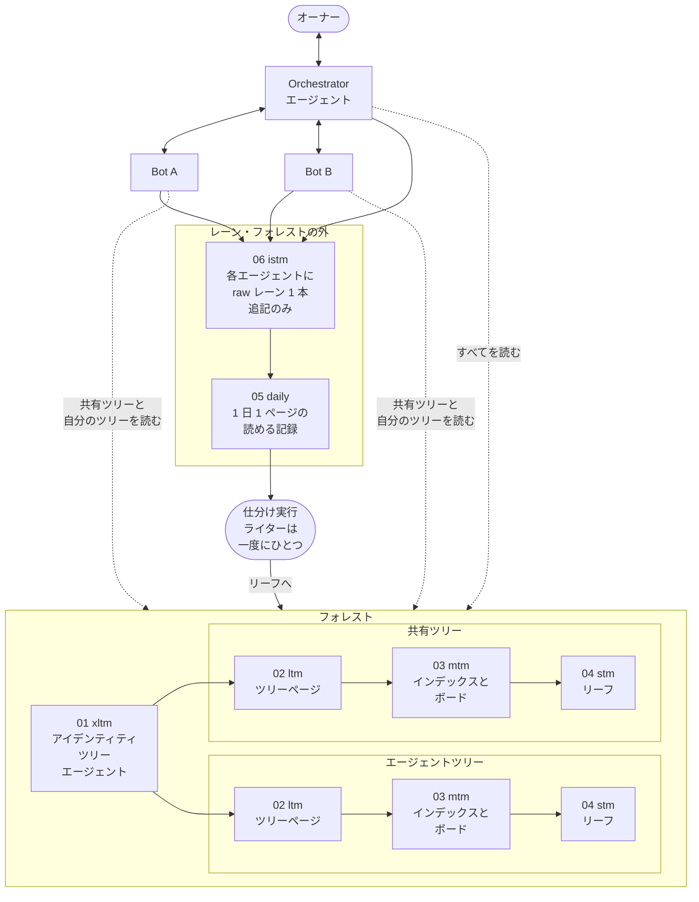
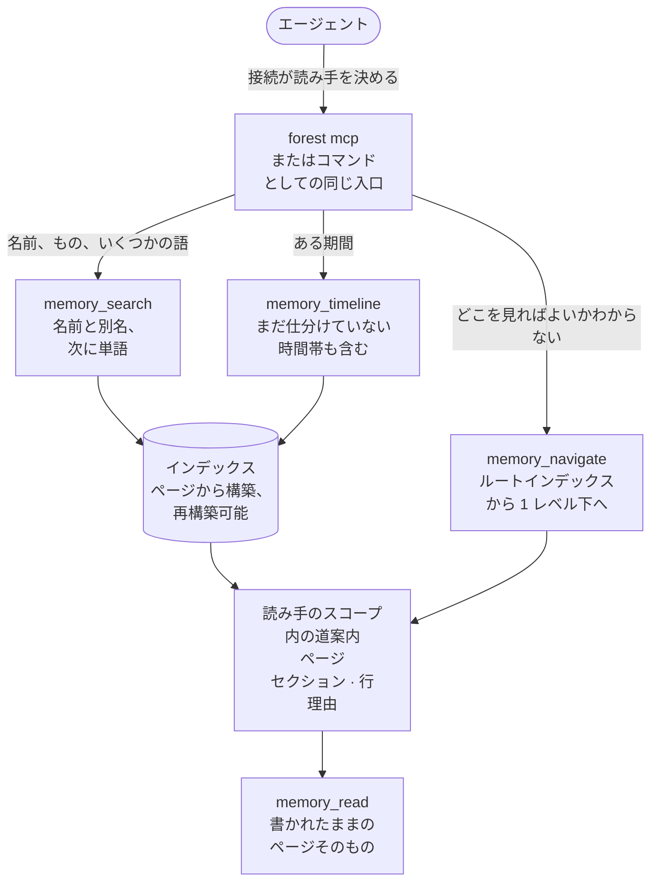

# Agent Memory Forest

**長時間動き続ける AI エージェントとエージェントのチームのための、人が読めて、ルールで保たれるローカルメモリーです。**

[English](README.md) · [한국어](README.ko.md) · [简体中文](README.zh-CN.md) · **日本語** · [Español](README.es.md) · [Français](README.fr.md) · [Deutsch](README.de.md)

[](https://github.com/hyungchulc/agent-memory-forest/actions/workflows/ci.yml)
[](https://www.python.org/)
[](LICENSE)
[](docs/privacy-and-trust.md)

Agent Memory Forest は、エージェントが学んだことを、手元のディスクにある番号付きの
いくつかのフォルダーへ、プレーンな Markdown ページとして残す Python パッケージと
`forest` コマンドです。どの事実にも置き場所はひとつだけで、その場所は事実を持ち込んだ
チャットやエージェントではなく、ルールによって決まります。ページをどこに置くか、あるサブジェクト
（subject）が専用のページを持つほど育ったかどうかを決めるのは、モデルではなくコードです。

**ステータス:** バージョン `1.0.0b1`。バージョン 1 の最初の公開リリースとなるベータ版です。
0.3 の `memory-forest` コマンドも並んでインストールされたまま残ります
（[アーカイブ](docs/archive-0.3/cli.md)）。

> [!IMPORTANT]
> Agent Memory Forest は、ホスティングされたサービスでも、認可システムでもなく、エージェントが
> 正しく記憶することを保証するものでもありません。メモリーは判断の根拠となるデータです。
> それでも呼び出し側は、案内されたページを自分で開き、その情報がどれだけ新しいかを確かめ、
> 自身の権限ルールと安全ルールを適用する必要があります。フォレスト（forest）は認証情報を
> 一切保持せず、オプションのベクトル検索を除くすべての機能がネットワークなしで動作します。

## はじめに

Python 3.11 以降と POSIX ファイルシステムが必要です。標準ライブラリ以外のランタイム依存は
ありません。Windows では WSL2 を使い、フォレストは Linux 側のファイルシステムに置いてください。
先に [WSL2 ガイド](docs/wsl2.md) を読んでください。このパッケージは PyPI にあります。
このリリースはベータ版なので、バージョンを指定するか、`--pre` を付けてインストールします。

```sh
python -m pip install "agent-memory-forest==1.0.0b1"
# バージョンを指定しない場合：
python -m pip install --pre agent-memory-forest
```

クローンからインストールする場合は、そのフォルダーで `python -m pip install .` を実行します。
インストールできたかどうかは `forest --version` で確認できます。`forest` コマンドがパスに
ない環境では、`python -m memory_forest.forest` が同じコマンドです。あとはエージェントに
一文だけ伝えます。

> `forest guide` を実行して、その内容に従ってください。

接続はエージェントが自分で行います。エージェントが `forest setup` を実行すると、あなたに
尋ねるべき質問が渡されるので、エージェントはそれをひとつずつあなたに尋ねます。フォレストを
どこに置くか、エージェントの名前、それがあなたのメインのエージェントかどうか、どの会話を
取り込むか、そしてフォレストを育て続けるのは誰か、です。あなたが答えるべき質問はすべて
あなたに届き、エージェントが自分で答えることはありません。そのあとエージェントは、
フォレストを新しく作るか、あなたが指定したフォレストに参加し、検索サーバーを自分のツールに
登録し、自分の会話を取り込み、`forest doctor` で結果を検証します。

## 含まれるもの

- **フォレストとそのルール。** プレーンなページを収めた番号付きフォルダーと、どのフォレストも
  守るひとつのコントラクト（contract）: [コントラクト](docs/contract.md)。初めて読む人向けの
  説明は [コンセプト](docs/concepts.md) にあります。
- **構造ツール。** `forest init`、`registry`、`move`、`levels`、`collections`、`record`、
  `archive`、`check`、`lint`、`numbers`、`credentials`、`recover`: [ツール](docs/tools.md)。
- **検索。** コマンドとしての `forest search`、`read`、`timeline`、`navigate` と、5 つのツール
  （`memory_search`、`memory_read`、`memory_timeline`、`memory_navigate`、`memory_log`）を
  持つ MCP サーバーの `forest mcp`: [ツール](docs/tools.md#forest-mcp)。
- **2 つの書き込み口。** エージェント自身のターンを書き込む `forest log` または `memory_log` と、
  レーンの形式で書かれ、`forest intake --from jsonl` が読み込むレコード:
  [ツール](docs/tools.md#forest-intake)。
- **エージェントごとのツリー（tree）。** 全員が必要とするものを置く共有ツリー、エージェント
  ごとの専用ツリー、そして読み取りスコープ: [エージェント](docs/multi-agent.md)。
- **guide、setup、doctor。** `forest guide`（setup、routine、use、contract）、`forest setup`、
  `forest doctor`: [エージェントの接続](docs/setup.md)、[ツール](docs/tools.md#forest-guide)。

## しないこと

- **特定のエージェントプログラムの会話ログは読みません。** 会話の保存形式はプログラムごとに
  異なり、パッケージがそのすべてに追従し続けることはできません。いくつかのプログラム向けに
  リーダー（reader）を同梱すれば、守れない約束をすることになります。自分のプログラムのことは
  エージェントが知っています。エージェントはガイドに従い、自分のターンをレコードとして
  追記する小さなエクスポーターを自分で書きます。あるプログラムに詳しい人は、そのプログラム
  用のリーダーを書くことができます（[アダプター](docs/adapters.md)）。
- **エンジンもタイマーもありません。** 日次記録（daily record）、仕分け実行（filing run）、
  保守実行（upkeep run）は、あなたのエージェントが `forest guide routine` に従い、自分の
  スケジュールと自分のモデルで行います。パッケージが担うのは判定です: `forest check`、
  `forest lint`、`forest levels`、`forest doctor`。
- **他のプログラムの設定には何も書き込まず**、プラグインもありません。セットアップが書き込む
  のはフォレストのフォルダーの中だけで、自分のツールに何を登録すればよいかはエージェントに
  伝えます。

## 手動で行う

エージェントを使わない場合も、同じ手順はいくつかのコマンドで済みます。回答なしで setup を
実行すると質問の一覧が表示され、すべての回答を渡すとフォレストを書き出して `todo` を表示します。

```sh
forest setup                                   # next: ask_owner と、各質問とそのフラグ
forest setup --root studio-forest --as "Kiln Bot" --main yes --conversations all --earlier no \
  --keeper this --when "every night at 23:30" --daily-model "small model" --filing-model "large model"
# next: done
# todo 1. register_mcp  2. bring_turns  3. own_turn  4. routine  5. verify、それぞれにコマンドが付く
```

`todo` を実行していきます。MCP クライアントに `forest mcp --as kiln-bot --root studio-forest` を
登録し、表示された `forest intake` コマンドか `forest log` でターンを取り込みます。そのうえで
確認します。

```sh
forest doctor --as "Kiln Bot" --root studio-forest --phrase   # 伝えるべき新しいフレーズを表示
forest log --as kiln-bot --root studio-forest <<'TURN'
Kiln Two fires to cone 5 for now. forest doctor phrase orchid maple amber
TURN
forest index build --root studio-forest
forest doctor --as "Kiln Bot" --root studio-forest              # result: passed (exit 0) または todo (exit 1)
```

フレーズは毎回変わります。手元の doctor が表示したものを取り込んでください。`finding`
チェックは、MCP クライアントがサーバーを一度呼び出した時点で通ります。それまで doctor は
`todo` を返し、登録すべき `forest mcp` コマンドを表示します。MCP クライアントがない場合は
コマンドが入口になります。doctor の行に `--doors commands` を加えると、doctor が実行する
検索がその証明になります。

回答は確実に守られます。フォレストを育てるエージェントはすべてのエージェントのターンを読む
ため、それはあなたのメインエージェントです（`--keeper this` に `--main no` を組み合わせると
もう一度質問されます）。また、あるエージェントについて `--conversations none` と答えると、
エクスポーターやフックがまだ動いていても、フォレスト自体がそのエージェントのターンを
拒否します（`recording_off`）。

## ドキュメント

| ドキュメント | 内容 |
| --- | --- |
| [コンセプト](docs/concepts.md) | 初めて読む人のためのフォレスト: レイヤー、サブジェクトの一生、置き場所はひとつ、上位に上がるもの、記録、移動、lint |
| [コントラクト](docs/contract.md) | フォレストが守るすべてのルールを、それぞれ一度ずつ記述 |
| [エージェントの接続](docs/setup.md) | `forest setup` が尋ねて書き込む内容と、`forest doctor` が証明する内容 |
| [エージェント](docs/multi-agent.md) | エージェントのツリー、2 つの仕分けポリシー、読み取りスコープ、単一ライター |
| [設計](docs/v1-design.md) | パッケージ: ディスク上のレイアウト、設定、パッケージマップ、マイルストーン |
| [ツール](docs/tools.md) | `forest move`、`levels`、`collections`、`check`、`lint`、`record`、`numbers`、`intake`、`index`、`search`、`timeline`、`log`、`mcp`、`guide`、`setup`、`doctor` |
| [リーダーの書き方](docs/adapters.md) | あるエージェントプログラム自身の会話ログを読むリーダー。そのプログラムに詳しい人向け |
| `forest guide` | セットアップガイド: エージェントが自分で接続するためにたどる手順 |
| `forest guide routine` | ルーティンガイド: フォレストを育てるエージェント向けの、日次記録、仕分け実行、保守実行 |
| `forest guide use` | 利用ガイド: エージェントがいつ、どのように情報を調べるか |
| `forest guide contract` | インストール済みのパッケージが出力するコントラクト |
| [比較](docs/comparison.md) | Mem0、GBrain、LLM Wiki のアイデア、素のベクトル RAG との違い |
| [プライバシーと信頼](docs/privacy-and-trust.md) | 何がローカルに残るか、読み手に何が見えるか、信頼できないデータとしてのメモリー |
| [ロードマップ](docs/roadmap.md) | 3 つのマイルストーンと、今後加わるかもしれないもの |
| [WSL2](docs/wsl2.md) | WSL2 を使って Windows で動かす |
| [0.3 のアーカイブ](docs/archive-0.3/) | バージョン 1 で置き換えられた 0.3 のドキュメント |

3 つのガイドとコントラクトはパッケージ内（`src/memory_forest/guide/`）に同梱されており、
上のコマンドがそれを出力します。そのため、エージェントはインストール済みのバージョンに
合ったものを読むことになります。リンク先のドキュメントは英語で書かれています。

## なぜ作ったのか

長時間動くエージェントのメモリーは、たいてい 2 通りのどちらかで破綻します。残す量が
少なすぎるか、何も見つけられず誰も直せなくなるまで膨らみ続ける山を抱えるかです。
バージョン 1 は、この問題に直接対処するいくつかの性質を軸に作られています。

- **単位はサブジェクトです。** 人、プロジェクト、デバイス、エージェント。それぞれが別名を
  含むレジストリの 1 行を持ち、その資料は専用の置き場所にまとまります。
- **配置はコードが決めます。** サブジェクトのレベル（共有ページ上の 1 項目、リーフ（leaf）、
  ブランチ（branch）、ツリー）は、その資料が何日分の異なる日にまたがるかで決まります。
  すべての移動は、参照を書き換えて移動を記録するひとつのツールを通ります。
- **事実ごとに置き場所はひとつです。** 他のページにはコピーではなく日付付きの参照行を置くので、
  同じ事実が食い違っていくことはありません。
- **履歴は残ります。** 変更された事実はそのページの更新記録（update record）に移り、長くなった
  記録はそのままの形でアーカイブされます。削除されるものはありません。
- **上位のページには確立したことだけが載ります。** 好みが要約ページに載るのは、繰り返し
  裏付けがあったときか、オーナー（owner）本人の言葉があったときだけです。いちばん新しい
  発言だからという理由で載ることはありません。
- **コード付きのリンター。** 形の決まったルールはすべてチェックされます。1 回の実行は自分が
  加えたものを片付けなければなりませんが、もともとあった問題に妨げられることはありません。
- **複数のエージェントを前提に設計。** エージェントごとの raw レーン（raw lane）、一度に
  ひとつだけのライター、読み取りスコープ、2 つの仕分けポリシーを備えています。

## 1 枚の図で見るフォレスト



資料はレーンからリーフへと上がり、リーフで確立したものだけがボードとツリーページへ
引き上げられます。配置はその逆向きに決まります。ルートインデックスがサブジェクトの種類ごとに
どのツリーに属するかを示し、ツリーがどのブランチかを示し、ブランチがリーフを持ちます。
エージェントのツリーも、ほかのツリーと同じ 3 つのレイヤーを持ちます。違うのは、いつ現れるか
（サブジェクトが育ってからではなく、エージェントの初日から）、何を持つか（デフォルトでは
エージェント自身のもの、つまり役割、指示、手法、教訓、実行）、そして誰が読むかです。
[コンセプト](docs/concepts.md) では、1 日だけの言及から専用のツリーを持つまで、ひとつの
サブジェクトの一生をたどります。

| フォルダー | 内容 |
| --- | --- |
| `01 xltm/XLTM.md` | ルートインデックス: オーナーが誰か、配置ルール付きのツリー一覧、エージェント一覧 |
| `02 ltm/<tree>_LTM.md` | ツリーごとに 1 ページ: 範囲、長く続くパターンとルール、現在の状態、ブランチ |
| `03 mtm/<tree>/` | ツリーのインデックス（サブジェクトのレジストリ）と、ブランチごとに 1 つのボード |
| `04 stm/<tree>/<branch>/` | リーフ: それぞれひとつのサブジェクトのひとつのサブトピックを詳細まで、内容は最大 8 KB |
| `05 daily/` | 各日の読める記録（レーン） |
| `06 istm/` | 生の記録。追記のみで、エージェントごとに 1 レーン（レーン） |
| `.forest/` | コンパイル済みのレジストリ、移動ログ、アーカイブ、インデックス、ロック |

## 5 行でわかる検索

フォレストに何かを求めるエージェントは、MCP サーバーである `forest mcp` を通じて、または
コマンドとしての同じ入口を通じて尋ねます。どのツールを呼ぶかは質問に何が含まれているかで
決まり、返ってくるのは結論ではなく、読むべき場所です: ページ、セクション、その行、そして
一致した理由。



架空の [合成フォレスト](examples/synthetic-forest/README.md) のコピーで、そのフォルダーの中から
実行します。

```sh
forest search "the big kiln" --as kiln-bot --limit 1       # サブジェクトの名前ではなく別名
# 03 mtm/studio/kiln-two.md
#   why: alias: "the big kiln" names kiln-two
#   ...
#   03 mtm/studio/kiln-two.md#rules lines 18-21
#     ## Rules
#
#     - Glaze loads fire to cone 5 until the new elements have run ten firings; Juno's decision of 2042-05-14 (as of 2042-05-14; source `04 stm/studio/kiln-two/settings.md`)
#   ...
# trees: studio
forest read "04 stm/studio/kiln-two/settings.md" --as kiln-bot --lines 14-15   # その行が出典に挙げるリーフ
# 04 stm/studio/kiln-two/settings.md
#   why: read
#   04 stm/studio/kiln-two/settings.md lines 14-15
#     - Glaze loads: cone 5 (1,196 °C) until the new elements have run ten firings. Juno, in the studio chat:
#       "Let's drop glaze loads to cone 5 until the new elements settle, ten firings or so."
#
# trees: studio
forest timeline query "2042-05-13" --as kiln-bot           # 1 日分: その日のリーフ、日次ページ、raw レーン
forest navigate --as kiln-bot                              # 検索する語がないとき: ルートインデックスから始める
forest read "02 ltm/kiln-bot_LTM.md" --as ledger-bot       # 別のエージェントのツリー
# forest: out_of_scope: That path is outside this reader's trees and lane.
#   path: 02 ltm/kiln-bot_LTM.md
#   next: fix
```

1. 入口は 2 つ、答えはひとつです。`forest mcp --as <agent>` は `memory_search`、`memory_read`、
   `memory_timeline`、`memory_navigate`、`memory_log` を、stdio またはループバックポートで
   MCP クライアントに提供します。`forest search`、`read`、`timeline`、`navigate`、`log` は
   コマンドとしての同じ入口で、スコープも答えも同じです。
2. インデックスは導出されたものです。`forest index build` はページとレーンからインデックスを
   書き出し（reset が新しいファイルを指すまでは `.forest/index.sqlite`）、ルーティンは 1 回の処理を
   終えるたびにこのコマンドを実行します。`forest index reset` のあとにビルドしても、同じ
   インデックスができます。検索はまず、ビルド以降に変わったレーンのファイルと日次ページを
   取り込むので、まだ仕分けていない時間帯も見つけられます。ツリーのページの変更は、次のビルドで
   取り込まれます。
3. 名前が単語より先です。検索はまずレジストリの名前と別名を試します: 質問で名指された
   サブジェクトについては、その置き場所と、`about:` でそれを名指すすべてのリーフが返ります。
   単語の一致はそのあとで、ベクトルの一致は、設定が埋め込み（embeddings）プロバイダーを名指し、
   そのプロバイダーを自分で登録してあるときだけです。パッケージ自体はひとつも登録せず、
   外向きのネットワーク呼び出しも行いません。
4. 結果は道案内です。結果はページごとにひとつで、一致した各セクションが書かれたままの形で、
   一致した理由と読むべき行とともに返ります。エージェントはそのページを開き、日付と更新記録を
   確かめ、自分のルールを適用します。メモリーが何かを認可することはありません。
5. 読み手は接続で決まります。誰が読むかは `--as` が示し、ツールの引数でも質問の言い回しでも
   それは変えられません。グループで共有する接続（`--as-group`）では、呼び出しごとに、その
   メンバーである自分のエージェント名を名乗ります。オーケストレーターはフォレスト全体と
   すべての raw レーンを読みます。その他のエージェントは、デフォルトでは共有ツリーと自分の
   ツリー、ルートインデックス、日次ページ、自分の raw レーンを読み、その外にあるパスは
   拒否されます。サインイン情報と、フォレストが認識するカード・口座・電話の番号は、
   インデックスでもすべての答えでも伏せ字になります。

詳しくは [ツール](docs/tools.md#forest-search-and-forest-read) を、エージェント自身向けには
`forest guide use` を参照してください。

## 5 行でわかるエージェント

複数のエージェントがひとつのフォレストを共有します。全員が必要とするものは共有ツリーに、
各エージェント固有のものはエージェントごとのツリーに置き、オーケストレーター
（orchestrator）がそのすべてを読みます。`forest setup` で参加したエージェントは、セットアップが
`done` を返した時点で自分のツリーを持っています。それ以外のエージェントのツリーは自動的に
できます。エージェントが自分の raw レーンに最初の 1 行を書くと、次の保守ステップがその
ツリーを作ります。

```sh
ls "my-forest/06 istm/post-bot"            # エージェントがここに最初の 1 行を書いた
# 2042-05-15.jsonl
forest levels apply --root my-forest       # コマンドひとつ。すべてのレベルを確定させるのと同じ保守ステップ
# post-bot: none -> tree (agent; its raw lane holds a file)
ls my-forest/"02 ltm"
# post-bot_LTM.md   studio_LTM.md          # そのツリーページ: 役割、指示、教訓、現在の状態、ブランチ
```

1. エージェント（オーケストレーター、ボット、スケジュール実行のステージ）は、最初の日から
   ツリーであるサブジェクトです。`forest log` または `memory_log` で書き込んだターンがツリーを
   作るか、別のライターがロックを解放したあとの次の書き込みまでツリーを保留にします。
   エージェントはその名前で表され、名前はどの文字体系でもかまいません。照合では保存済みの id
   との完全一致が名前キーより優先され、これはフォレスト全体を対象に、グループの所属を見るより
   先に行われます。名前はページの構文上必要な箇所でエンコードされ、いったん受け入れた名前が
   別の名前ルールで拒否されることはありません。設定エントリーや intake レーンによって作成待ちの
   まま残ったツリーは、`forest levels apply` が作ります。
2. そのツリーページには、役割、常設の指示、教訓、現在の状態、ブランチが置かれます。
3. `subject-first`（デフォルト）は、事実をサブジェクトの置き場所に `noted by <agent>` の印を
   付けて仕分けます。`agent-first` は事実をエージェントのツリーに `about:` ポインター付きで
   仕分け、2 つのエージェントが同じ事実を持った時点でそれを共有します。
4. オーケストレーターはフォレスト全体を読み、その他のエージェントは共有ツリーと自分の
   ツリーを読みます。
5. 各エージェントは自分の raw レーンに追記し、フォレストへの書き込みはロックを取った
   仕分け実行が一度にひとつだけ行います。

レーンへのコミットの時点で `stored` とターン id が確定します。id、呼び出し元キーとソースの
レコード、ツリー、インデックス、接続の管理情報はそこから導出され、未完了のものには
`pending` と理由が付きます。

クラッシュで応答が失われた場合、呼び出し側にはターンが保存されたかどうかを知る手段が
ありません。そのキーを付けて呼び出しを繰り返しても安全です。

詳しくは [エージェント](docs/multi-agent.md) を参照してください。

## コマンド一覧

`--root` を指定した場合、コマンドはそのフォルダーを使います。指定しない場合は、現在の
フォルダーかその上位にある、`forest.toml` を含む最も近いフォルダーを使います。`forest init` と
`forest setup` はフォレストを作成し、`forest guide` はフォレストを必要としません。下のブロック
はフォレストを作成してその中に移動するので、続く各行がそのファイルを見つけられます。

```sh
# マイルストーン 1: 骨組みと構造ツール
forest init my-forest                          # 設定、レイヤー、ルートインデックス
cd my-forest                                   # 以下のコマンドはこのフォルダーのフォレストを使う
forest move new-agent studio-hub --name "Studio Hub" --role "orchestrator"   # またはそのレーンに作らせる
forest registry build                          # すべての ## Subjects セクションをコンパイル
forest levels check                            # 新しいレベルに進む時期が来たサブジェクトとエージェント
forest levels apply                            # それを移動ツールで実行し、ログに残す
forest check --sync                            # 導出されたリストをページに合わせてから、すべてのチェックを実行
forest lint                                    # 形の決まったすべてのルールを、コード別に
forest repeats check                           # ひとつのサブジェクトの 2 つのリーフが共有している事実の行
forest record kinds                            # 更新記録の行を種類別に
forest numbers check --all                     # 口座・カード・身分証・電話の番号が完全な形で書かれた箇所

# マイルストーン 2: 接続と検索
forest setup --root . --as "Kiln Bot" --main yes --conversations all --earlier no --keeper nobody
                                               # オーナーの回答: エージェント、そのツリー、その記録ファイル
forest intake --from jsonl --as kiln-bot --transcript transcripts/kiln-bot.jsonl --once
                                               # エクスポーターが追記したレコードを、エージェントの raw レーンへ
forest intake status                           # アダプターが解釈できなかった行
forest log --as kiln-bot                       # ターンは stdin から読み込む
forest index build                             # .forest/index.sqlite、再構築可能
forest search "cone 5" --as kiln-bot           # まず別名、次に単語。読み手のスコープ内で
forest timeline query "yesterday evening" --as kiln-bot
forest navigate --as kiln-bot                  # ルートインデックスから 1 レベル下へ
forest mcp --as kiln-bot                       # search、read、timeline、navigate、memory_log
forest agents                                  # グループ、レーン、各エージェントを最後に確認した時刻
forest guide                                   # セットアップガイド。残りのパートは `routine`、`use`、`contract`
forest setup                                   # 回答なしの場合: エージェントがオーナーに尋ねる質問 (exit 1)
forest doctor --as kiln-bot                    # ターンが届き、MCP サーバーが呼ばれたことを証明 (両方そろうまで exit 1)

# マイルストーン 3: 成長。日次記録、仕分け実行、保守実行はあなた自身のエージェントが
# `forest guide routine` に従って行い、上のコマンドがその書いた内容を判定します。
```

コードを動かす前にフォレストがどのようなものか見ておきたい場合は、架空の
[合成フォレスト](examples/synthetic-forest/README.md) を読んでください。オーナー 1 人、
共有ツリー 3 つ、オーケストレーター 1 つとボット 2 つ、2 日分の日次ページと raw レーンから
なる、40 ほどの小さなファイルの集まりです。

## ステータス

Agent Memory Forest はベータ版のソフトウェアです。このソースツリーのバージョンは 1.0.0b1 で、
バージョン 1 の最初の公開リリースです。

- **作成済み:** コントラクト、設計、コンセプトとエージェントのガイド、そしてコントラクトに
  従う架空の合成フォレスト。
- **マイルストーン 1、骨組み:** `forest` の構造コマンド（registry、move、levels、collections、
  履歴ファイルを持つ record、archive、`check`、`lint`、番号の伏せ字化、`recover`）、レーンまたは
  設定から作られるエージェントのツリー、すべてのコミットに対する取り消し用ジャーナル。架空の
  フォレストを使ったテストがあり、合成フォレストはすべてのチェックを通過します。
- **マイルストーン 2、接続と検索:** `forest intake` はレーンの形式のレコード（`jsonl`
  アダプター、またはエントリーポイントグループ `memory_forest.adapters` を通じて誰かが組み込んだ
  アダプター）を、そのエージェントの raw レーンに読み込みます。`forest log` と `memory_log` は
  エージェント自身のターンを書き込みます。`forest index` は検索インデックスを構築します
  （`forest index reset` が新しいファイルを指すまでは `.forest/index.sqlite`）。`forest search`、
  `forest read`、`forest timeline`、`forest navigate` はそのインデックスから
  `agents.readable_trees` の範囲内で答え、`forest mcp` は search、read、timeline、navigate、
  `memory_log` を提供します。オーナーのエージェントは `forest guide`、`forest setup`、
  `forest doctor` を使って自分で接続します（[設計、セクション 15](docs/v1-design.md#15-connecting-agents)）。
- **マイルストーン 3、成長:** 日次記録、仕分け実行、夜間の保守は、オーナー自身のエージェントが
  コントラクト（セクション 10）と `forest guide routine` に従って行います。
- **このリリースに含まれないもの:** 特定のエージェントプログラム自身の会話ログを読むリーダー
  （そのプログラムに詳しい人がリーダーを書きます。[アダプター](docs/adapters.md)）と、日次・
  仕分け・保守の各ステージを実行するエンジン。

0.3 のコード（`memory-forest`）は、このソースツリーにバージョン 1 と並んで残っています。
評価や改変の材料には適していますが、人が見ていない状態で重大な判断を下す用途には向きません。

## コントリビュート

[CONTRIBUTING.md](CONTRIBUTING.md) を読んでください。フィクスチャーは架空の内容にし、実際の
フォレストは Git の外に置き、プルリクエストを出す前にローカルでチェック一式を実行してください。

```sh
make check
```

セキュリティ上の問題の扱いは [SECURITY.md](SECURITY.md) に、コミュニティへの参加は
[CODE_OF_CONDUCT.md](CODE_OF_CONDUCT.md) に従います。

## ライセンス

Agent Memory Forest は [MIT License](LICENSE) のもとで公開されています。
