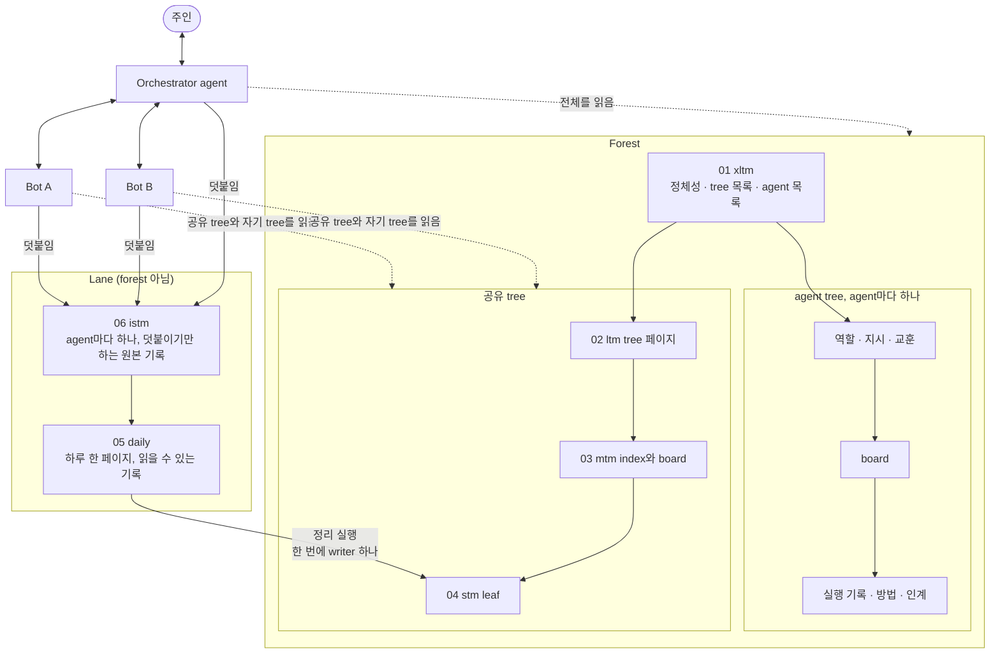

# Agent Memory Forest

**오래 일하는 AI agent와 agent 팀을 위한, 사람이 읽을 수 있고 규칙으로 관리되는 로컬 메모리입니다.**

[English README](README.md)

[](https://github.com/hyungchulc/agent-memory-forest/actions/workflows/ci.yml)
[](https://www.python.org/)
[](LICENSE)
[](docs/privacy-and-trust.md)

Agent Memory Forest는 agent가 알게 된 것을 내 디스크의 번호 붙은 몇 개 폴더 안에 평범한 Markdown 페이지로
남기는 Python 패키지이자 `forest` 명령입니다. 사실마다 집이 하나 있고, 그 집은 사실을 가져온 대화나 agent가
아니라 규칙이 정합니다. 페이지가 어디에 있어야 하는지, 어떤 subject가 자기 페이지를 가질 만큼 자랐는지는
model이 아니라 코드가 판단합니다. 여러 agent가 하나의 forest를 함께 씁니다. 모두에게 필요한 것은 공유 tree에,
각 agent 자신의 것은 agent마다 하나씩 있는 tree에 두고, orchestrator는 전체를 읽습니다. agent의 tree는 저절로
생깁니다. agent가 자기 raw lane에 첫 줄을 쓰면, 다음 관리 단계가 그 tree를 만듭니다.

```sh
ls "my-forest/06 istm/post-bot"            # agent가 여기에 첫 줄을 썼습니다
# 2042-05-15.jsonl
forest levels apply --root my-forest       # 명령 하나: 모든 subject의 단계를 정하는 바로 그 관리 단계
# post-bot: none -> tree (agent; its raw lane holds a file)
ls my-forest/"02 ltm"
# post-bot_LTM.md   studio_LTM.md          # tree 페이지: 역할, 지시, 교훈, 현재 상태, branch
```

버전 1은 0.3 Memory Forest의 다음 세대입니다. 규칙은 모두 문서로 정리되어 있고, 코드는 세 단계에 걸쳐
옮기는 중입니다. 자세한 내용은 [현재 상태](#현재-상태)를 보세요.

> [!IMPORTANT]
> Agent Memory Forest는 hosted service도, 권한 시스템도, agent가 정확히 기억한다는 보장도 아닙니다. 메모리는
> 판단의 근거일 뿐입니다. 호출하는 쪽이 안내받은 페이지를 직접 열어 얼마나 최신인지 확인하고, 자기 권한과
> 안전 규칙을 따로 적용해야 합니다. forest는 credential을 보관하지 않으며, 선택 사항인 vector 검색을 빼면
> 모든 기능이 network 없이 동작합니다.

## 왜 만들었나

오래 일하는 agent의 메모리는 대개 둘 중 하나로 무너집니다. 너무 적게 남기거나, 아무것도 찾을 수 없고 아무도
고칠 수 없을 때까지 쌓이기만 합니다. 버전 1은 이 문제를 정면으로 다루는 몇 가지 원칙 위에 서 있습니다.

- **단위는 subject입니다.** 사람, 프로젝트, 기기, agent마다 별칭까지 담은 registry 한 줄이 있고, 그 자료는
  자기 자리에 모입니다.
- **자리는 코드가 정합니다.** subject가 공유 페이지의 한 항목인지, leaf인지, branch인지, tree인지는 그 자료가
  걸쳐 있는 서로 다른 날짜의 수로 정해집니다. 모든 이동은 참조를 고쳐 쓰고 기록을 남기는 하나의 도구를
  거칩니다.
- **사실마다 집은 하나입니다.** 다른 페이지에는 복사본 대신 날짜가 붙은 참조 한 줄만 둡니다. 그래서 같은
  사실이 여기저기서 어긋날 일이 없습니다.
- **이력은 남습니다.** 바뀐 사실은 그 페이지의 update record로 옮겨지고, 길어진 기록은 그대로 archive에
  보관되며, 지워지는 것은 없습니다.
- **위층에는 확실한 것만 올라갑니다.** 취향이나 습관은 여러 날에 걸친 근거가 있거나 주인이 직접 말했을 때만
  요약 페이지에 올라갑니다. 가장 최근에 나온 말이라는 이유만으로는 올라가지 않습니다.
- **코드로 검사하는 lint가 있습니다.** 모양이 있는 규칙은 모두 검사합니다. 한 번의 실행은 자기가 만든 문제를
  스스로 정리해야 하지만, 원래 있던 문제 때문에 막히지는 않습니다.
- **여러 agent를 위한 구조입니다.** agent별 raw lane, 한 번에 하나뿐인 writer, 읽기 범위, 두 가지 정리
  방식을 갖추고 있습니다.

## 한눈에 보는 forest



자료는 lane에서 leaf로 올라가고, leaf가 뒷받침하는 것만 board와 tree 페이지로 올라갑니다. 자리를 정할 때는
반대로 위에서 내려옵니다. root index가 어떤 종류의 subject가 어느 tree에 속하는지 정하고, tree가 branch를,
branch가 leaf를 정합니다. 하루 한 번 스친 이름이 자기 tree를 갖게 되기까지의 과정은
[Concepts](docs/concepts.md)에서 한 subject를 따라가며 설명합니다.

| 폴더 | 담는 것 |
| --- | --- |
| `01 xltm/XLTM.md` | root index: 주인이 누구인지, tree 목록과 배치 규칙, agent 목록 |
| `02 ltm/<tree>_LTM.md` | tree마다 한 페이지: 범위, 오래 가는 패턴과 규칙, 현재 상태, branch |
| `03 mtm/<tree>/` | tree의 index(subject registry)와 branch마다 하나씩 있는 board |
| `04 stm/<tree>/<branch>/` | leaf: subject 하나의 하위 주제 하나를 원문 수준으로, 본문 8 KB 이내 |
| `05 daily/` | 하루하루의 읽을 수 있는 기록 (lane) |
| `06 istm/` | 덧붙이기만 하는 원본 기록, agent마다 하나 (lane) |
| `.forest/` | 컴파일된 registry, 이동 기록, archive, index, lock |

## 빠른 시작

Python 3.11 이상과 POSIX filesystem이 필요하며, 표준 라이브러리 밖의 runtime dependency는 없습니다.
Windows에서는 WSL2를 쓰고 forest를 Linux filesystem 안에 두세요. 먼저 [WSL2 guide](docs/wsl2.md)를 읽어
주세요.

```sh
git clone https://github.com/hyungchulc/agent-memory-forest.git
cd agent-memory-forest
python3 -m venv .venv
. .venv/bin/activate
python -m pip install -e .
```

버전 1의 명령은 [설계 문서의 package map](docs/v1-design.md#13-package-map)에 있는 `forest …` 명령들입니다.
**버전 1.0.0b1은 이 트리의 beta이며, 안정 배포는 아닙니다.** 아래 milestone 1 명령은 이 저장소에 들어 있고 함께 설치됩니다.
milestone 2에서는 intake, 검색 index, timeline, 읽기 범위, MCP server가 이 저장소에 있습니다. setup
(`forest setup`, `forest doctor`, 에이전트용 안내)은 만드는 중입니다. 특정 에이전트 프로그램의 대화 기록을
읽는 reader와, daily·정리·관리 단계를 돌리는 엔진은 첫 배포에 들어가지 않습니다. 에이전트는 `forest log`,
`memory_log`, `jsonl` 어댑터, 또는 그 프로그램을 아는 사람이 꽂아 넣는 어댑터로 자기 대화를 들여오고,
그 단계들은 주인의 에이전트가 직접 합니다(contract 10장). 0.3의 `memory-forest` 명령([`docs/archive-0.3/`](docs/archive-0.3/cli.md)에
설명)도 나란히 설치된 채로 남아 있습니다.

`forest init`만 새 forest를 만듭니다. 다른 명령은 `--root`를 주면 그 폴더를 쓰고, 아니면 현재 폴더와 그
위쪽에서 `forest.toml`이 있는 가장 가까운 폴더를 씁니다. 아래는 forest를 만든 뒤 그 폴더로 들어가서,
이어지는 줄이 그 파일을 찾게 합니다.

```sh
# Milestone 1: 뼈대와 구조 도구
forest init my-forest                          # 설정, 계층, root index
cd my-forest                                   # 아래 명령은 이 폴더의 forest를 씁니다
forest move new-agent studio-hub --name "Studio Hub" --role "orchestrator"   # 또는 lane이 만들게 둡니다
forest registry build                          # 모든 ## Subjects 섹션을 컴파일
forest levels check                            # 단계가 바뀔 때가 된 subject와 agent
forest levels apply                            # 이동 도구로 실제로 옮기고 기록
forest check --sync                            # 파생 목록을 페이지에 맞춘 뒤 모든 검사
forest lint                                    # 모양이 있는 모든 규칙을 code로 검사
forest repeats check                           # 한 subject의 두 leaf가 함께 가진 사실 줄
forest record kinds                            # update record의 줄을 종류별로
forest numbers check --all                     # 가리지 않고 다 적힌 계좌·카드·신분증·전화번호

# Milestone 2: intake, index, 검색, timeline, MCP server는 이 저장소에 있음. setup은 아직 없음
forest intake --from jsonl --once              # lane 모양의 새 기록만 그 agent의 raw lane으로
forest intake status                           # 어댑터가 알아보지 못한 줄의 수
forest index build                             # .forest/index.sqlite, 지우고 다시 만들 수 있음
forest search "the old oven" --as till-bot     # 별칭을 먼저, 그다음 단어, 읽는 쪽의 범위 안에서
forest timeline query "yesterday evening" --as till-bot
forest mcp --as till-bot                       # search, read, timeline, navigate, memory_log
forest mcp --as-group studio-counter           # 에이전트 여럿이 연결 하나. 호출마다 자기 이름을 냄
forest log --as kiln-bot                       # 턴은 stdin으로
forest agents                                  # 그룹, lane, 연결에서 마지막으로 보인 때
forest setup                                   # 만드는 중: 에이전트가 실행
forest doctor                                  # 만드는 중: 턴이 들어오고 MCP server가 답하는지 확인

# Milestone 3: 자라기. daily, 정리, 관리 단계는 주인의 에이전트가 직접 합니다
# (contract 10장). 그 단계를 돌리는 엔진은 첫 배포에 들어가지 않습니다.
```

코드가 돌기 전에 forest가 어떻게 생겼는지 보고 싶다면 가상의 [synthetic forest](examples/synthetic-forest/README.md)를
읽어 보세요. 주인 한 명, 공유 tree 셋, orchestrator와 bot 둘, 이틀치 daily 페이지와 raw lane까지 작은 파일
마흔 개 남짓으로 되어 있습니다.

## agent를 다섯 줄로

1. agent(orchestrator, bot, 예약 실행 단계)는 첫날부터 tree인 subject입니다. 설정 항목이나 raw lane의 첫
   파일만 있으면 되고, tree는 `forest levels apply`가 만듭니다. `forest log`와 `memory_log`는 바로
   tree를 만들거나 다른 writer가 lock을 잡고 있으면 `pending`으로 답합니다. lock이 풀린 뒤 다음
   write가 tree를 만듭니다. forest 전체에서 정확한 저장 id, 이름 key 순서로 agent를 찾고 나서
   group 멤버인지 확인합니다. 이미 허용한 이름은 페이지 문법에 맞게 인코딩하며 다시 거절하지 않습니다.
2. agent의 tree 페이지에는 역할, 고정 지시, 교훈, 현재 상태, branch가 있습니다.
3. 기본값인 `subject-first`는 사실을 그 subject의 집에 두고 `noted by <agent>`라고 표시합니다.
   `agent-first`는 agent의 tree에 두고 `about:`으로 가리키다가, 두 agent가 같은 사실을 알게 되면 공유합니다.
4. orchestrator는 forest 전체를 읽고, 다른 agent는 공유 tree와 자기 tree를 읽습니다.
5. agent마다 자기 raw lane에 덧붙이기만 하고, forest에는 lock을 잡은 정리 실행 하나만 씁니다.

자세한 내용은 [Agents](docs/multi-agent.md)에 있습니다.

## 문서

| 문서 | 내용 |
| --- | --- |
| [Concepts](docs/concepts.md) | 처음 읽는 사람을 위한 설명: 계층, subject의 일생, 사실의 집, 위로 올라가는 것, 기록, 이동, lint |
| [Contract](docs/contract.md) | forest가 지켜야 할 모든 규칙을 한 번씩 |
| [Agents](docs/multi-agent.md) | agent tree, 두 가지 정리 방식, 읽기 범위, writer 하나 원칙 |
| [Design](docs/v1-design.md) | 패키지: 디스크 구조, 설정, package map, milestone |
| [Tools](docs/tools.md) | `forest move`, `levels`, `collections`, `check`, `lint`, `record`, `numbers`, `intake`, `index`, `search`, `timeline`, `mcp` |
| [Comparison](docs/comparison.md) | Mem0, GBrain, LLM Wiki 아이디어, 일반 vector RAG와 무엇이 다른지 |
| [Privacy and trust](docs/privacy-and-trust.md) | 무엇이 로컬에 남는지, 읽는 쪽이 무엇을 볼 수 있는지, 신뢰할 수 없는 데이터로서의 메모리 |
| [Roadmap](docs/roadmap.md) | 세 milestone과 그 다음 |
| [WSL2](docs/wsl2.md) | Windows에서 WSL2로 쓰는 법 |
| [0.3 archive](docs/archive-0.3/) | 버전 1이 대체한 0.3 문서 |

문서는 영어로 쓰여 있습니다.

## 현재 상태

Agent Memory Forest는 beta 단계이며, 이 트리의 버전은 1.0.0b1입니다.

- **작성 완료:** contract, 설계, concepts와 agents 안내서, contract를 따르는 가상의 synthetic forest.
- **Milestone 1, 뼈대 (이 저장소에 있음, 미배포):** `forest` 구조 명령(registry, move, levels, collections,
  history 파일을 쓰는 record, archive, `check`, `lint`, 번호 가리기, `recover`), lane이나 설정에서 만들어지는
  agent tree, 모든 commit의 되돌리기 journal. 가상 forest로 하는 테스트가 있고, synthetic forest는 모든
  검사를 통과합니다.
- **Milestone 2, 연결하고 찾기 (intake, index, 검색, MCP server는 이 저장소에 있음):** `forest intake`가
  lane 모양의 기록(`jsonl` 어댑터, 또는 entry point group `memory_forest.adapters`로 꽂아 넣은 어댑터)을
  그 agent의 raw lane으로 받습니다. `forest index`가 `.forest/index.sqlite`를 만들고,
  `forest search`, `forest read`, `forest timeline`이 그 index에서 `agents.readable_trees` 범위로 답합니다.
  `forest mcp`는 search, read, timeline, navigate, `memory_log`를 제공합니다. `--as-group`은 에이전트
  여럿이 연결 하나를 쓸 때입니다. 에이전트는 그 이름이고(어느 문자로 쓴 이름이든), 그룹은 서로를 막는 벽이
  아닙니다. 호출 하나가 턴 하나이고, `forest log`는 그 쓰기의 명령입니다. 주인의 agent가 직접 하는
  설치(`forest setup`, `forest doctor`, 안내)는 만드는 중입니다
  ([design 15장](docs/v1-design.md#15-connecting-agents)).
- **Milestone 3, 자라기:** daily 기록, 정리 실행, 야간 관리는 주인의 에이전트가 contract(10장)와 안내를
  따라 직접 합니다.
- **첫 배포에 들어가지 않는 것:** 특정 에이전트 프로그램의 대화 기록을 읽는 reader(프로그램을 아는 사람이
  어댑터로 만듭니다), daily·정리·관리 단계를 돌리는 엔진.

0.3 코드(`memory-forest`)는 버전 1 명령이 대신할 때까지 저장소에 남아 있습니다. 평가하고 응용해 보기에는
알맞지만, 사람이 지켜보지 않는 중요한 결정에 쓸 수준은 아닙니다.

## 기여

[CONTRIBUTING.md](CONTRIBUTING.md)를 읽어 주세요. fixture는 지어낸 내용으로만 만들고, 실제 forest는 Git 밖에
두고, pull request 전에 전체 검사를 돌려 주세요.

```sh
make check
```

보안 문제는 [SECURITY.md](SECURITY.md)를, 커뮤니티 참여는 [CODE_OF_CONDUCT.md](CODE_OF_CONDUCT.md)를
따릅니다.

## License

[MIT License](LICENSE)로 공개합니다.
