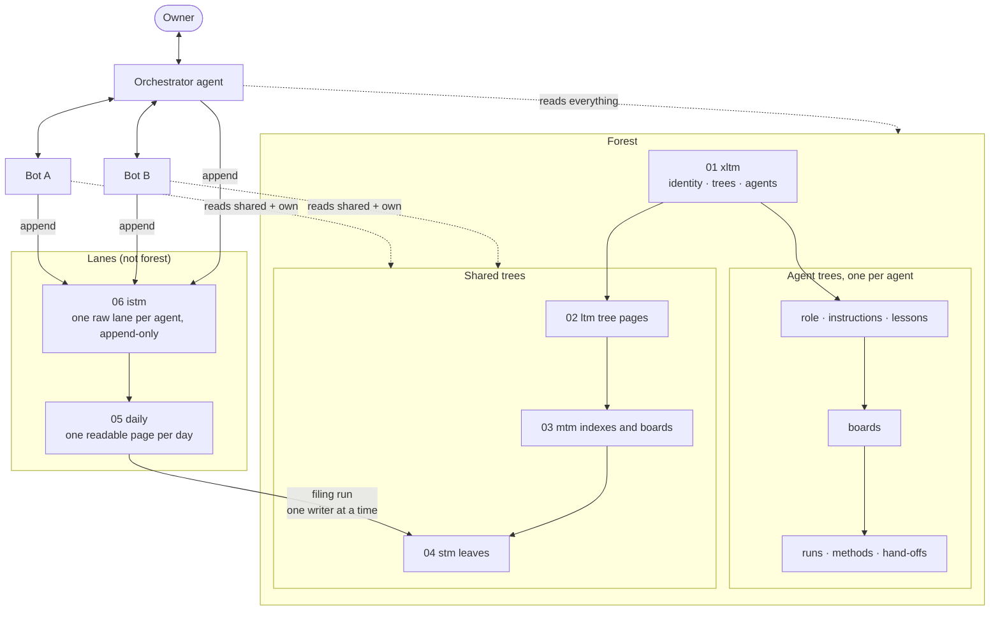

# Agent Memory Forest

**A readable, rule-kept local memory for long-running AI agents and teams of agents.**

[한국어 README](README.ko.md)

[](https://github.com/hyungchulc/memory-forest/actions/workflows/ci.yml)
[](https://www.python.org/)
[](LICENSE)
[](docs/privacy-and-trust.md)

Agent Memory Forest keeps what an agent learns as plain Markdown pages in a few numbered folders. Every fact
has one home, decided by rules rather than by the chat or the agent that brought it in; a changed fact keeps
what it was before; a moved page is still found under its old path; and code, not a model, decides where a
page belongs and when a subject has grown enough to get pages of its own. Several agents can share one
forest: shared trees for what everyone needs, a tree per agent for what is its own, and an orchestrator that
reads all of it.

Version 1 is a new generation of the 0.3 Memory Forest. Its rules are written down in full; its code is
being ported in three milestones (see [Status](#status)).

> [!IMPORTANT]
> Agent Memory Forest is not a hosted service, an authorization system, or a promise that an agent will
> remember correctly. Memory is grounding data: a caller still opens the page it was routed to, checks how
> fresh it is, and applies its own authority and safety rules. The forest holds no credentials, and
> everything except optional vector search works with no network.

## Why this exists

A long-running agent tends to fail at memory in one of two ways: it keeps too little, or it keeps a pile
that grows until nothing in it can be found and nobody can correct it. Version 1 is built around a few
properties that address that directly.

- **The subject is the unit.** A person, a project, a device, an agent: each has one registry line with its
  aliases, and its material lives in its own home.
- **Places are decided by code.** A subject's level (an entry on a shared page, a leaf, a branch, a tree)
  follows the number of distinct days its material covers. Every move goes through one tool that rewrites
  references and logs the move.
- **One home for each fact.** Other pages carry a dated reference line, not a copy, so facts cannot drift
  apart.
- **History is kept.** A changed fact moves to the page's update record; long records are archived
  verbatim; nothing is deleted.
- **Upper pages hold what is established.** A preference reaches a summary page only on repeated evidence
  or the owner's own words, never because it is the newest thing said.
- **A linter with codes.** Every rule that has a shape is checked, and a run must clean up what it added
  without being blocked by what was already there.
- **Built for several agents.** Raw lanes per agent, one writer at a time, reader scopes, and two filing
  policies.

## The forest in one picture



Material moves up from the lanes into the leaves, and only what the leaves establish is carried up to the
boards and tree pages. Placement goes the other way: the root index says which tree a kind of subject
belongs to, the tree says which branch, the branch holds the leaf. [Concepts](docs/concepts.md) walks
through one subject's life from a one-day mention to a tree of its own.

| Folder | Holds |
| --- | --- |
| `01 xltm/XLTM.md` | the root index: who the owner is, the list of trees with placement rules, the list of agents |
| `02 ltm/<tree>_LTM.md` | one page per tree: scope, durable patterns and rules, current state, branches |
| `03 mtm/<tree>/` | the tree's index (its registry of subjects) and one board per branch |
| `04 stm/<tree>/<branch>/` | the leaves: one sub-topic of one subject each, in full detail, at most 8 KB of content |
| `05 daily/` | the readable record of each day (a lane) |
| `06 istm/` | the raw record, append-only, one lane per agent (a lane) |
| `.forest/` | the compiled registry, the move log, the archive, indexes and locks |

## Quick start

Agent Memory Forest needs Python 3.11 or newer, a POSIX filesystem, and no runtime dependencies outside the
standard library. On Windows, use WSL2 and keep the forest on the Linux filesystem; read the
[WSL2 guide](docs/wsl2.md) first.

```sh
git clone https://github.com/hyungchulc/memory-forest.git
cd memory-forest
python3 -m venv .venv
. .venv/bin/activate
python -m pip install -e .
```

The version 1 commands are the `forest …` commands of the [design's package map](docs/v1-design.md#13-package-map).
**None of them is released yet.** Each line below is marked with the milestone that brings it; until
milestone 1 lands, the installed command is still the 0.3 `memory-forest` (documented in
[`docs/archive-0.3/`](docs/archive-0.3/cli.md)).

```sh
# Milestone 1: skeleton and structure tools
forest init my-forest                          # settings, layers, root index
forest move new-agent studio-hub --name "Studio Hub" --role "orchestrator"
forest registry build                          # compile every ## Subjects section
forest levels check                            # which subjects are due a new level
forest levels apply                            # carry them out through the move tool, logged
forest check                                   # bring derived lists up to the pages
forest lint                                    # every rule with a shape, by code

# Milestone 2: finding
forest search "the big kiln"                   # registry aliases first, then words (and vectors if set)
forest timeline query "yesterday evening"
forest mcp                                     # search, read, navigate, timeline with the reader's scope

# Milestone 3: growing
forest stage …                                 # the daily, filing and upkeep stages around your model
```

To see what a forest looks like before any code runs, read the invented
[synthetic forest](examples/synthetic-forest/README.md): an owner, three shared trees, an orchestrator and
two bots, two days of daily pages and a raw lane, about forty small files.

## Agents in five lines

1. An agent (an orchestrator, a bot, a scheduled stage) is a subject that is a tree from its first day.
2. Its tree page holds its role, standing instructions, lessons, current state and branches.
3. `subject-first` (default) files facts in the subject's home tagged `noted by <agent>`; `agent-first`
   files them in the agent's tree with `about:` pointers, and shares a fact once two agents hold it.
4. An orchestrator reads the whole forest; other agents read shared trees and their own.
5. Each agent appends to its own raw lane, and one filing run at a time writes the forest under a lock.

Details: [Agents](docs/multi-agent.md).

## Documentation

| Document | What it covers |
| --- | --- |
| [Concepts](docs/concepts.md) | the forest for a new reader: layers, a subject's life, one home, what goes up, records, moves, the lint |
| [Contract](docs/contract.md) | every rule a forest keeps, stated once |
| [Agents](docs/multi-agent.md) | agent trees, the two filing policies, reader scopes, the single writer |
| [Design](docs/v1-design.md) | the package: on-disk layout, settings, package map, milestones |
| [Comparison](docs/comparison.md) | how this differs from Mem0, GBrain, the LLM Wiki idea and plain vector RAG |
| [Privacy and trust](docs/privacy-and-trust.md) | what stays local, what a reader can see, memory as untrusted data |
| [Roadmap](docs/roadmap.md) | the three milestones and what comes after |
| [WSL2](docs/wsl2.md) | running on Windows through WSL2 |
| [Archive of 0.3](docs/archive-0.3/) | the 0.3 documents that version 1 replaces |

## Status

Agent Memory Forest is alpha software. Version 1.0.0 is unreleased.

- **Written:** the contract, the design, the concepts and agents guides, and an invented synthetic forest
  that follows the contract.
- **Milestone 1, skeleton:** the structure tools (registry, move, levels, collections, record, archive,
  derived lists, lint) with tests on made-up forests, and the synthetic forest passing the lint.
- **Milestone 2, finding:** the time index, search with reader scopes, the MCP server.
- **Milestone 3, growing:** the stage programs and their prompts, the nightly upkeep.

The 0.3 code (`memory-forest`) stays in this tree until the version 1 commands replace it. It is suitable
for evaluation and adaptation, not for unattended high-stakes decisions.

## Contributing

Read [CONTRIBUTING.md](CONTRIBUTING.md). Keep fixtures invented, keep real forests outside Git, and run the
full local check before opening a pull request.

```sh
make check
```

Security issues follow [SECURITY.md](SECURITY.md). Community participation follows
[CODE_OF_CONDUCT.md](CODE_OF_CONDUCT.md).

## License

Agent Memory Forest is released under the [GNU General Public License v3.0](LICENSE).
