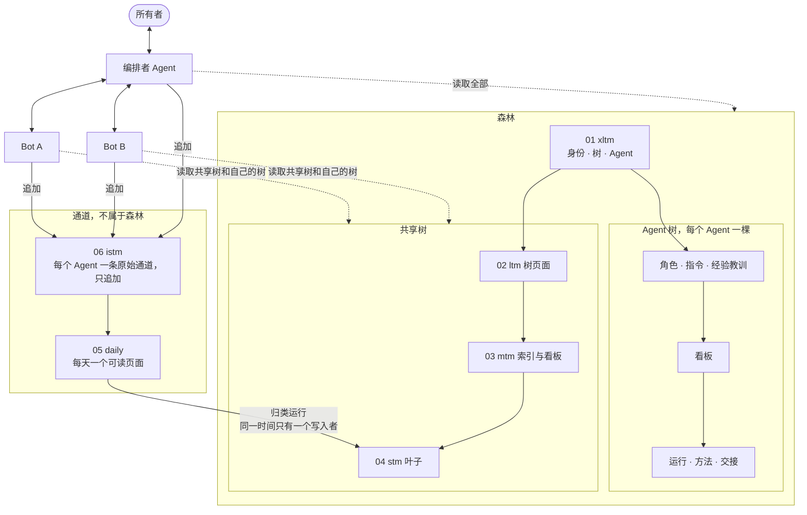

# Agent Memory Forest

**一种可读、按规则维护的本地记忆，面向长期运行的 AI Agent 和多 Agent 团队。**

[English](README.md) · [한국어](README.ko.md) · **简体中文** · [日本語](README.ja.md) · [Español](README.es.md) · [Français](README.fr.md) · [Deutsch](README.de.md)

[](https://github.com/hyungchulc/agent-memory-forest/actions/workflows/ci.yml)
[](https://www.python.org/)
[](LICENSE)
[](docs/privacy-and-trust.md)

Agent Memory Forest 是一个 Python 包，也是一个 `forest` 命令。它把 Agent 学到的东西保存为普通的
Markdown 页面，放在你自己磁盘上几个带编号的文件夹里。每条事实只有一个归属位置（home），
由规则决定，而不是由带来它的对话或 Agent 决定；页面该放在哪里、某个主题（subject）
是否已经积累到足以拥有自己的页面，都由代码而不是模型来判断。

**状态：** 版本 `1.0.0b1`，beta 版，也是版本 1 的首个公开发布。0.3 版的 `memory-forest`
命令仍与它并存安装（[归档](docs/archive-0.3/cli.md)）。

> [!IMPORTANT]
> Agent Memory Forest 不是托管服务，不是授权系统，也不保证 Agent 会正确地记住。记忆是用作依据的数据
> （grounding data）：调用方仍要亲自打开被引导到的页面，检查它有多新，并执行自己的权限和安全规则。
> 森林不保存任何凭据；除了可选的向量搜索，所有功能都无需联网。

## 从这里开始

你需要 Python 3.11 或更高版本，以及 POSIX 文件系统；除标准库外没有任何运行时依赖。
在 Windows 上请使用 WSL2，并把森林（forest）放在 Linux 文件系统中；请先阅读
[WSL2 指南](docs/wsl2.md)。本包没有发布到任何包索引上，请通过仓库地址安装：

```sh
python -m pip install "git+https://github.com/hyungchulc/agent-memory-forest"
```

也可以在克隆下来的仓库文件夹里运行 `python -m pip install .`。用 `forest --version` 检查安装；
如果 `forest` 命令不在 PATH 中，`python -m memory_forest.forest` 就是同一个命令。然后，
对你的 Agent 说一句话：

> 运行 `forest guide`，照着它做。

Agent 会自己完成接入。它运行 `forest setup`，后者把需要问你的问题交给它，它再逐一问你：
森林放在哪里、Agent 叫什么名字、它是不是你的主 Agent、要导入哪些对话、由谁负责让森林持续生长。
凡是该由你回答的问题都会交给你，Agent 从不替你作答。随后它会新建森林，或加入你指定的那个森林，
把查找服务器注册到它自己的工具里，导入它自己的对话，并用 `forest doctor` 验证结果。

## 你会得到什么

- **森林及其规则。** 由普通页面组成的编号文件夹，以及每个森林都遵守的一份契约（contract）：
  [契约](docs/contract.md)，面向新读者的讲解见[概念](docs/concepts.md)。
- **结构工具。** `forest init`、`registry`、`move`、`levels`、`collections`、`record`、
  `archive`、`check`、`lint`、`numbers`、`credentials` 和 `recover`：[工具](docs/tools.md)。
- **查找。** 以命令形式提供的 `forest search`、`read`、`timeline` 和 `navigate`，以及 `forest mcp`，
  一个带五个工具（`memory_search`、`memory_read`、`memory_timeline`、`memory_navigate`、
  `memory_log`）的 MCP 服务器：[工具](docs/tools.md#forest-mcp)。
- **两个写入入口。** 供 Agent 写入自己轮次（turn）的 `forest log` 或 `memory_log`；以及符合通道（lane）格式、
  由 `forest intake --from jsonl` 读取的记录：[工具](docs/tools.md#forest-intake)。
- **每个 Agent 一棵树。** 共享树存放所有人都需要的内容，每个 Agent 另有一棵自己的树（tree），
  以及读取范围（reader scope）：[Agent](docs/multi-agent.md)。
- **指南、setup 与 doctor。** `forest guide`（setup、routine、use、contract）、`forest setup` 和
  `forest doctor`：[连接 Agent](docs/setup.md) 和[工具](docs/tools.md#forest-guide)。

## 它不做什么

- **它不读取任何特定 Agent 程序的对话记录（transcript）。** 每个程序都用自己的格式保存对话，
  本包不可能全部跟上；只为其中几个提供读取器，就等于许下无法兑现的承诺。你的 Agent 了解它自己的程序：
  按照指南，它会自己写一个小型导出器（exporter），把自己的轮次以记录的形式追加进来。
  熟悉某个程序的人可以为它编写读取器（[适配器](docs/adapters.md)）。
- **它没有引擎，也没有定时器。** 每日记录（daily record）、归类运行（filing run）和维护运行
  （upkeep run）都由你的 Agent 依照 `forest guide routine`，按它自己的日程、用它自己的模型来执行。
  本包负责裁定：`forest check`、`forest lint`、`forest levels` 和 `forest doctor`。
- **它不向其他程序的设置写入任何内容**，也没有插件。setup 只在森林的文件夹内写入，
  并告诉 Agent 该在它自己的工具里注册什么。

## 手动操作

不借助 Agent 时，同样的流程只需几条命令。不带任何回答运行 setup，会列出问题；带齐所有回答时，
它会写出森林并打印它的 `todo`：

```sh
forest setup                                   # next: ask_owner，以及每个问题对应的 flag
forest setup --root studio-forest --as "Kiln Bot" --main yes --conversations all --earlier no \
  --keeper this --when "every night at 23:30" --daily-model "small model" --filing-model "large model"
# next: done
# todo 1. register_mcp  2. bring_turns  3. own_turn  4. routine  5. verify，每一项都附带对应的命令
```

照着 `todo` 做：在你的 MCP 客户端中注册 `forest mcp --as kiln-bot --root studio-forest`，
再用打印出来的 `forest intake` 命令或 `forest log` 导入轮次。然后验证：

```sh
forest doctor --as "Kiln Bot" --root studio-forest --phrase   # 打印一个要说的新短语
forest log --as kiln-bot --root studio-forest <<'TURN'
Kiln Two fires to cone 5 for now. forest doctor phrase orchid maple amber
TURN
forest index build --root studio-forest
forest doctor --as "Kiln Bot" --root studio-forest              # result: passed (exit 0)，或 todo (exit 1)
```

短语每次都是新的；导入你的 doctor 打印出的那一个。MCP 客户端调用过一次服务器后，`finding` 检查即通过；
在此之前，doctor 会报告 `todo`，并打印需要注册的 `forest mcp` 命令。没有 MCP 客户端时，
命令本身就是入口：在 doctor 那一行加上 `--doors commands`，doctor 执行的那次搜索就是证明。

这些回答是作数的。维护森林的 Agent 会读取所有 Agent 的轮次，所以它就是你的主 Agent
（`--keeper this` 搭配 `--main no` 会被重新询问）。而当你为某个 Agent 回答 `--conversations none` 时，
无论还有什么导出器或 hook 在运行，森林本身都会拒收该 Agent 的轮次（`recording_off`）。

## 文档

| 文档 | 内容 |
| --- | --- |
| [概念](docs/concepts.md) | 面向新读者的森林介绍：分层、一个主题的生命周期、唯一归属位置、哪些内容会向上提升、记录、移动、lint |
| [契约](docs/contract.md) | 森林遵守的每一条规则，每条只陈述一次 |
| [连接 Agent](docs/setup.md) | `forest setup` 会问什么、写什么，以及 `forest doctor` 能证明什么 |
| [Agent](docs/multi-agent.md) | Agent 树、两种归类策略、读取范围、单一写入者 |
| [设计](docs/v1-design.md) | 包本身：磁盘布局、设置、包结构图、里程碑 |
| [工具](docs/tools.md) | `forest move`、`levels`、`collections`、`check`、`lint`、`record`、`numbers`、`intake`、`index`、`search`、`timeline`、`log`、`mcp`、`guide`、`setup` 和 `doctor` |
| [编写读取器](docs/adapters.md) | 读取某个 Agent 程序自身对话记录的读取器，供熟悉该程序的人编写 |
| `forest guide` | setup 指南：Agent 自行接入时遵循的步骤 |
| `forest guide routine` | 例行指南：每日记录、归类运行和维护运行，供维护森林的 Agent 使用 |
| `forest guide use` | 使用指南：Agent 何时以及如何查找信息 |
| `forest guide contract` | 契约，内容以已安装的包打印出的为准 |
| [对比](docs/comparison.md) | 与 Mem0、GBrain、LLM Wiki 思路以及普通向量 RAG 有何不同 |
| [隐私与信任](docs/privacy-and-trust.md) | 哪些内容留在本地、读取方能看到什么、把记忆当作不可信数据 |
| [路线图](docs/roadmap.md) | 三个里程碑，以及以后可能加入的内容 |
| [WSL2](docs/wsl2.md) | 在 Windows 上通过 WSL2 运行 |
| [0.3 归档](docs/archive-0.3/) | 已被版本 1 取代的 0.3 文档 |

三份指南和契约随包一起发布（`src/memory_forest/guide/`），由上面这些命令打印出来，
因此 Agent 读到的总是与它所安装版本相符的那一份。上面链接的文档均为英文。

## 为什么做这个

长期运行的 Agent 在记忆上往往以两种方式之一失败：要么记得太少，要么越堆越多，
直到里面什么都找不到，也没人能纠正。版本 1 围绕几条直接针对这一问题的特性构建。

- **以主题为单位。** 一个人、一个项目、一台设备、一个 Agent：每个主题在注册表中有一行，列出它的别名，
  它的资料都放在它自己的归属位置。
- **位置由代码决定。** 一个主题处于哪一层级（共享页面上的一个条目、一片叶子（leaf）、一个分支（branch）、一棵树），
  取决于它的资料覆盖了多少个不同的日期。每次移动都经过同一个工具，由它改写引用并记录这次移动。
- **每条事实只有一个归属位置。** 其他页面只放一行带日期的引用，而不是副本，因此事实不会各自走样。
- **历史会被保留。** 发生变化的事实会移到页面的更新记录中；过长的记录原样归档；什么都不删除。
- **上层页面只放已经确立的内容。** 一项偏好只有在反复得到证据、或所有者（owner）亲口说过时，才会进入摘要页面，
  绝不会仅仅因为它是最新说的话就进去。
- **带规则代码的 linter。** 凡是有明确形态的规则都会被检查；一次运行必须清理掉它自己新增的问题，
  但不会被原本就存在的问题卡住。
- **为多个 Agent 设计。** 每个 Agent 一条原始通道（raw lane）、同一时间只有一个写入者、读取范围，以及两种归类策略。

## 一图看懂森林



资料从通道向上流入叶子，只有叶子已经确立的内容才会继续提升到看板（board）和树页面。
确定位置则是反方向：根索引说明某类主题属于哪棵树，树说明属于哪个分支，分支容纳叶子。
[概念](docs/concepts.md)跟着一个主题走完它的一生，从某天被提到一次，到拥有自己的一棵树。

| 文件夹 | 存放内容 |
| --- | --- |
| `01 xltm/XLTM.md` | 根索引：所有者是谁、带放置规则的树列表、Agent 列表 |
| `02 ltm/<tree>_LTM.md` | 每棵树一页：范围、长期有效的模式与规则、当前状态、分支 |
| `03 mtm/<tree>/` | 该树的索引（即它的主题注册表），以及每个分支一个看板 |
| `04 stm/<tree>/<branch>/` | 叶子：每片对应一个主题的一个子话题，内容完整详尽，正文不超过 8 KB |
| `05 daily/` | 每一天的可读记录（属于通道） |
| `06 istm/` | 原始记录，只追加，每个 Agent 一条通道（属于通道） |
| `.forest/` | 编译后的注册表、移动日志、归档、索引和锁 |

## Agent 五要点

多个 Agent 共用一个森林：共享树存放所有人都需要的内容，每个 Agent 有一棵树存放它自己的内容，
编排者（orchestrator）则读取全部。用 `forest setup` 加入的 Agent，在 setup 回答 `done` 时就已经有了
自己的树。其他 Agent 的树会自动出现：某个 Agent 向自己的原始通道写入第一行后，
下一个维护步骤就会为它建树。

```sh
ls "my-forest/06 istm/post-bot"            # Agent 在这里写下了第一行
# 2042-05-15.jsonl
forest levels apply --root my-forest       # 一条命令，也就是确定所有层级的那个维护步骤
# post-bot: none -> tree (agent; its raw lane holds a file)
ls my-forest/"02 ltm"
# post-bot_LTM.md   studio_LTM.md          # 它的树页面：角色、指令、经验教训、当前状态、分支
```

1. Agent（编排者、bot、定时执行的阶段）是一种从第一天起就是一棵树的主题。
   它用 `forest log` 或 `memory_log` 写入的轮次会建出这棵树，或者将建树挂起（pending），
   留给另一个写入者释放锁之后的下一次写入。Agent 就是它的名字，名字可以用任何文字书写。
   在整个森林范围内，精确匹配已存储的 id 优先于名字键，二者又都先于分组成员关系。
   页面语法需要时，名字会被编码；已被接受的名字绝不会再被第二条命名规则拒绝。
   设置项或 intake 通道留下的待建树，由 `forest levels apply` 建出。
2. 它的树页面存放它的角色、长期指令、经验教训、当前状态和分支。
3. `subject-first`（默认）把事实归类到主题的归属位置，并标注 `noted by <agent>`；
   `agent-first` 则把事实归类到 Agent 自己的树中，附带 `about:` 指针，一旦两个 Agent 持有同一事实，就将其共享。
4. 编排者读取整个森林；其他 Agent 读取共享树和自己的树。
5. 每个 Agent 向自己的原始通道追加内容，同一时间只有一次归类运行在锁的保护下写入森林。

通道提交即确定 `stored` 和轮次 id；各类 id、调用方 key 与来源记录、树、索引以及连接相关的簿记都由此派生，尚未完成的标为 `pending` 并附上原因。

如果崩溃导致应答丢失，调用方无法知道该轮次是否已存储；用同一个 key 重复调用是安全的。

详情：[Agent](docs/multi-agent.md)。

## 全部命令

传入 `--root` 时，命令使用它；否则使用当前文件夹或其上层中最近的、包含 `forest.toml` 的文件夹。
`forest init` 和 `forest setup` 会创建森林；`forest guide` 不需要森林。下面这段命令先创建一个森林并进入其中，
因此后面每一行都能找到这个文件。

```sh
# 里程碑 1：骨架与结构工具
forest init my-forest                          # 设置、分层、根索引
cd my-forest                                   # 下面的命令使用的就是这个文件夹里的森林
forest move new-agent studio-hub --name "Studio Hub" --role "orchestrator"   # 也可以让它的通道来建
forest registry build                          # 编译每个 ## Subjects 小节
forest levels check                            # 哪些主题和 Agent 该进入新层级了
forest levels apply                            # 通过移动工具执行这些变更，并记入日志
forest check --sync                            # 先让派生列表跟上页面，再运行所有检查
forest lint                                    # 每条有明确形态的规则，按规则代码报告
forest repeats check                           # 同一主题的两片叶子共有的事实行
forest record kinds                            # 按类型列出更新记录中的行
forest numbers check --all                     # 完整写出的账号、卡号、证件号和电话号码

# 里程碑 2：连接与查找
forest setup --root . --as "Kiln Bot" --main yes --conversations all --earlier no --keeper nobody
                                               # 所有者的回答：Agent、它的树、它的记录文件
forest intake --from jsonl --as kiln-bot --transcript transcripts/kiln-bot.jsonl --once
                                               # 把导出器追加的记录导入该 Agent 的原始通道
forest intake status                           # 适配器没能识别的行
forest log --as kiln-bot                       # 轮次从 stdin 读取
forest index build                             # .forest/index.sqlite，可重新构建
forest search "cone 5" --as kiln-bot           # 先查别名，再查词语，限于读取方的范围内
forest timeline query "yesterday evening" --as kiln-bot
forest navigate --as kiln-bot                  # 从根索引往下走一层
forest mcp --as kiln-bot                       # search、read、timeline、navigate、memory_log
forest agents                                  # 分组、通道，以及每个 Agent 最后一次出现的时间
forest guide                                   # setup 指南；`routine`、`use` 和 `contract` 是另外几部分
forest setup                                   # 不带回答时：Agent 要问其所有者的问题（exit 1）
forest doctor --as kiln-bot                    # 验证有轮次到达、MCP 服务器被调用过（两者都满足前为 exit 1）

# 里程碑 3：生长。每日记录、归类运行和维护运行由你自己的 Agent 执行，
# 遵循 `forest guide routine`；上面的命令负责评判它写下的内容。
```

想在运行任何代码之前看看森林长什么样，可以阅读虚构的
[合成森林](examples/synthetic-forest/README.md)：一个所有者、三棵共享树、一个编排者和两个 bot、
两天的每日页面和一条原始通道，共约四十个小文件。

## 状态

Agent Memory Forest 是 beta 软件。此代码树中的版本是 1.0.0b1，也是版本 1 的首个公开发布。

- **已写成：** 契约、设计、概念与 Agent 两份指南，以及一个遵循契约的虚构合成森林。
- **里程碑 1，骨架：** `forest` 结构命令（registry、move、levels、collections、带历史文件的 record、
  archive、`check`、`lint`、号码星号遮蔽、`recover`），由通道或设置建出的 Agent 树，
  以及每次提交都有的撤销日志；附有基于虚构森林的测试，合成森林通过全部检查。
- **里程碑 2，连接与查找：** `forest intake` 把符合通道格式的记录（通过 `jsonl` 适配器，
  或通过入口点组 `memory_forest.adapters` 接入的适配器）读入该 Agent 的原始通道，
  `forest log` 和 `memory_log` 写入 Agent 自己的轮次。`forest index` 构建搜索索引
  （在 `forest index reset` 指向新文件之前，是 `.forest/index.sqlite`）。`forest search`、
  `forest read`、`forest timeline` 和 `forest navigate` 基于该索引、在 `agents.readable_trees` 范围内作答，
  `forest mcp` 提供 search、read、timeline、navigate 和 `memory_log`。所有者的 Agent 通过
  `forest guide`、`forest setup` 和 `forest doctor` 自行接入
  （[设计文档第 15 节](docs/v1-design.md#15-connecting-agents)）。
- **里程碑 3，生长：** 每日记录、归类运行和夜间维护由所有者自己的 Agent 执行，
  遵循契约（第 10 节）和 `forest guide routine`。
- **不在本次发布范围内：** 特定 Agent 程序自身对话记录的读取器（由熟悉该程序的人编写，
  [适配器](docs/adapters.md)），以及运行每日、归类和维护阶段的引擎。

0.3 版代码（`memory-forest`）与版本 1 一同保留在此代码树中。它适合用于评估和改造，
不适合在无人值守的情况下做高风险决策。

## 参与贡献

请阅读 [CONTRIBUTING.md](CONTRIBUTING.md)。测试夹具（fixture）一律使用虚构内容，真实的森林放在 Git 之外，
提交 pull request 之前先运行完整的本地检查。

```sh
make check
```

安全问题请按 [SECURITY.md](SECURITY.md) 处理。参与社区请遵守
[CODE_OF_CONDUCT.md](CODE_OF_CONDUCT.md)。

## 许可证

Agent Memory Forest 以 [MIT 许可证](LICENSE)发布。
